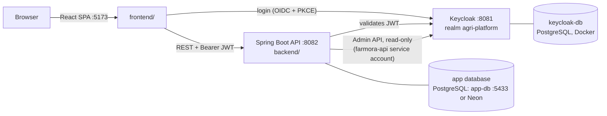
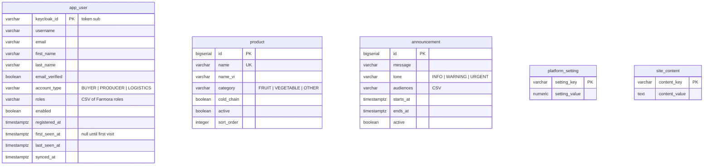

# Farmora: Agri Supply-Demand Platform

Farmora connects farm **supply** (batches declared by producers and cooperatives) with **demand** (orders posted by buyers such as supermarkets and kitchens). It accounts for harvest time, shelf life, distance and the cold chain. The system matches supply and demand automatically. Coordinators handle the exceptions, and logistics providers carry the goods.

This README is the handover entry point:

- [What exists today](#status-what-is-real-and-what-is-demo)
- [How to run it](#run-it-locally)
- [How it is built](#architecture)
- [What the database holds](#database)
- [Where to read next](#documentation)

## Status: what is real and what is demo

| Part | State |
| --- | --- |
| Sign-up, login, password reset, role-based routing | **Real**: Keycloak (realm `agri-platform`) |
| Admin area: page text, announcements, operating rules, product catalog | **Real**: Spring Boot API + PostgreSQL |
| User table (`app_user`): recorded at sign-in, synced from Keycloak | **Real**: API + PostgreSQL |
| Producer, buyer, coordinator, logistics areas: batches, demands, matching, holds, orders, deliveries, fleet, temperature | **UI prototypes on demo data in the browser**. Nothing is saved, and the areas do not share state. |

The next big step is moving batches, demands and matching into the database. See [Next steps](#next-steps).

## Roles

| Role | How you get it | Lands on | Does |
| --- | --- | --- | --- |
| Producer | Sign-up (account type) | `/producer` | Declares batches, accepts matches, confirms orders |
| Buyer | Sign-up | `/buyer` | Posts demands, reserves supply, tracks deliveries |
| Logistics provider | Sign-up | `/logistics` | Declares fleet and capacity, accepts transport orders, reports trip status and incidents |
| Coordinator | Granted by an admin in Keycloak | `/coordinator` | Monitors exceptions, approves cases that need a person, handles incidents |
| Admin | Granted by an admin in Keycloak | `/admin` | Changes site text, announcements, rules and products; sees all users |

Pre-provisioned admin: **`farmora.admin` / `Admin@123`**. The password is temporary, and Keycloak asks for a new one at the first login. The Keycloak console itself (`http://localhost:8081`) uses `admin` / `admin` from `.env`.

## Architecture



| Layer | Stack | Folder |
| --- | --- | --- |
| Frontend | React 19, Vite 8, TypeScript, React Router 7, keycloak-js | `frontend/` |
| API | Spring Boot 3.5 (Java 21), OAuth2 resource server, Spring Data JPA, Flyway | `backend/` |
| Identity | Keycloak 26 with the Farmora login theme and a role-assigner extension | `docker/keycloak/` |
| App database | PostgreSQL 16: local `app-db` container, or a shared Neon project | `backend/src/main/resources/db/migration/` |

Some rules hold across all layers:

- The API trusts **only the token** for who the user is (`sub`, `preferred_username`, realm roles). It never trusts ids sent in a request body.
- `/api/public/**` is open.
- `/api/admin/**` needs `ROLE_ADMIN`, checked twice: in `SecurityConfig` and with `@PreAuthorize`.
- Every other `/api/**` needs a valid token.
- Errors come back as problem details with a readable `detail`.

## Run it locally

You need Docker Desktop, JDK 21, Maven 3.9+ and Node 20.19+ (or 22.12+). The full guide, with troubleshooting, is in [docs/setup](docs/setup/README.md).

```powershell
# 1. Config
Copy-Item .env.example .env
Copy-Item frontend/.env.example frontend/.env.local
Copy-Item backend/.env.example backend/.env     # leave commented to use the local app-db

# 2. Keycloak + PostgreSQL
docker compose up -d --build
#    first time only: apply the account-type field and, for an older realm, the farmora-api client
#    (commands in docs/setup, "Apply the registration account-type field" and "Create the user-sync client")

# 3. API (from backend/)
mvn spring-boot:run

# 4. Frontend (from frontend/)
npm install
npm run dev
```

| URL | What |
| --- | --- |
| http://localhost:5173 | The app |
| http://localhost:8082/api/health | API health |
| http://localhost:8081 | Keycloak (its root opens the *master* console; that is normal) |

Checks: `mvn -q -f backend/pom.xml test`, then `npm run lint` and `npm run build` in `frontend/`.

## Database

There are **two separate PostgreSQL databases**. They are never joined.

| Database | Owner | Holds | Where |
| --- | --- | --- | --- |
| `keycloak-db` | Keycloak | Accounts, password hashes, roles, sessions, realm settings | Docker only (not published to the host) |
| App database (`farmora` locally, `neondb` on Neon) | Farmora API | Everything Farmora itself stores (below) | `app-db` container on port 5433, or Neon |

The app never reads Keycloak's tables. It gets users from tokens and from the Keycloak Admin API.

### Choosing the app database

The API reads `APP_DB_URL`, `APP_DB_USER` and `APP_DB_PASSWORD` from `backend/.env` (ignored by git) or from the environment.

- **Local (default):** leave them unset. The API uses `jdbc:postgresql://localhost:5433/farmora` (the `app-db` container).
- **Shared (Neon):** set the JDBC form of the Neon connection, with pooling turned off:
  `jdbc:postgresql://<host>.neon.tech/neondb?sslmode=require&channelBinding=require`, plus the user and password on their own lines.
  - Share the credentials privately and never commit them.
  - With Neon, only `keycloak-db` and `keycloak` need to run in Docker.

### Tables today



| Table | Purpose | Written by |
| --- | --- | --- |
| `app_user` | Everyone with a Farmora account. Keyed by the **Keycloak id**, which stays the same if a username changes. No passwords. | `GET /api/me` at each sign-in; `POST /api/admin/users/sync` (Keycloak Admin API) |
| `product` | Product catalog used in demand and batch forms and sheet imports. Seeded with 11 fruits. Products are switched off, never deleted. | Admin → Products |
| `announcement` | Messages from the admin, shown under the bell (on a banner for producers and the public site), with audience and time window | Admin → Announcements |
| `platform_setting` | Operating rules that differ from the default: auto-match score, sign-off kg, hold hours, cold-chain range… | Admin → Operating rules |
| `site_content` | Landing-page text that differs from the default | Admin → Site content |

The configuration tables, along with the `updated_by` / `updated_at` columns they also carry, are described in [docs/admin](docs/admin/README.md#database).

Two design rules:

- `platform_setting` and `site_content` store **only overrides**. The defaults live in code (`PlatformRule.java`, `siteContent.ts`), so "restore default" deletes the row.
- `app_user` is the anchor for every future business table: anything owned by a person references `app_user.keycloak_id`.

### Migrations

Flyway applies the files in `backend/src/main/resources/db/migration/` when the API starts. Hibernate only checks the schema (`ddl-auto: validate`).

| Version | File | Adds |
| --- | --- | --- |
| V1 | `V1__site_configuration.sql` | `site_content`, `announcement`, `platform_setting`, `product` (+ seed) |
| V2 | `V2__app_user.sql` | `app_user` |
| V3 | `V3__app_user_keycloak_sync.sql` | Optional visit times; `enabled`, `registered_at`, `synced_at` |

Change the schema only with a **new** `V4__….sql`. Never edit an applied file: Flyway checksums them, and the API refuses to start. Never alter tables by hand on Neon either; the entity check fails at start-up. To try a migration safely, create a Neon branch and point `backend/.env` at it.

### Planned business tables

These are not built yet. The role areas still run on demo data.

| Table | For |
| --- | --- |
| `organization` | A producer's cooperative, a buyer's company or a logistics company: name, tax code, address, logo URL (images go to object storage, not the database). Owner → `app_user`. |
| `delivery_point` | A buyer's delivery addresses |
| `batch` | Supply: product, kg, harvest date, shelf life, location, price |
| `demand` | Need: product, kg, deadline, delivery point, price range |
| `match` / `hold` | System-proposed pairing, with score and reasons; reservations with expiry |
| `transport_order`, `trip`, `vehicle`, `temperature_reading` | Logistics and the cold chain |

## Repository map

| Path | Contents |
| --- | --- |
| `frontend/src/components/screens/<Area>/` | One folder per area (Producer, Buyer, Coordinator, Logistics, Admin, LandingPage, Auth): pages, `sections/`, `data/` (demo data and logic), `styles/` |
| `frontend/src/lib/` | `keycloak.ts` (login, roles), `api.ts` (API calls), `site.ts` / `siteContent.ts` (admin configuration with defaults), `spreadsheet.ts` (Excel/CSV import) |
| `frontend/src/components/notifications/` | Notification bell and announcement banner, shared by all areas |
| `backend/src/main/java/com/agrisupply/platform/` | `config/` (security, role mapping), `controller/`, `service/`, `domain/` (entities), `repository/`, `dto/` |
| `backend/src/main/resources/` | `application.yml`, Flyway migrations |
| `docker/keycloak/` | Realm import, user profile, login theme, role-assigner extension |
| `compose.yml` | `keycloak-db`, `keycloak`, `app-db` |
| `docs/` | Handover documentation (below) |

## Documentation

| Doc | Read it for |
| --- | --- |
| [System flow and demo script](docs/system/README.md) | **Start here**: how the roles fit together and the order of the demo |
| [Local setup](docs/setup/README.md) | Running everything, ports, Keycloak first-time steps, Neon, troubleshooting |
| [Authentication](docs/auth/README.md) | Keycloak, tokens, role routing, the role-assigner extension |
| [Admin area](docs/admin/README.md) | Admin pages, the API, the database in detail, the user sync |
| [Producer](docs/producer/README.md) · [Buyer](docs/buyer/README.md) · [Coordinator](docs/coordinator/README.md) · [Logistics](docs/logistics/README.md) | Each role's screens and flow |

## Next steps

1. **Core data in the database.** Migrations and APIs for `organization`, `batch` and `demand`. Then switch the producer and buyer areas from demo data to the API, so the roles finally share state.
2. **Matching on the server.** Matching is the core feature: score supply against demand on the API and store the score and its reasons with each match. Holds and approvals follow from there.
3. **Orders, logistics and temperature** on the same model.
4. **Shared environments.** One Keycloak for the whole team; today each person's local Keycloak feeds the shared Neon `app_user` table. A hosted frontend and API.
5. Smaller items: a bell for producers, history and undo for admin changes, a scheduled user sync, and marking users deleted in Keycloak.
