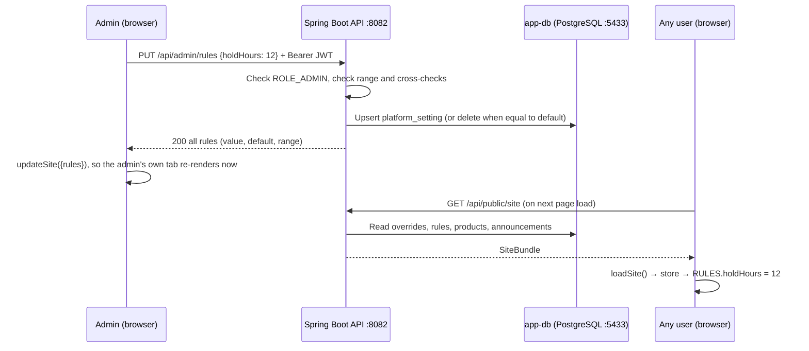
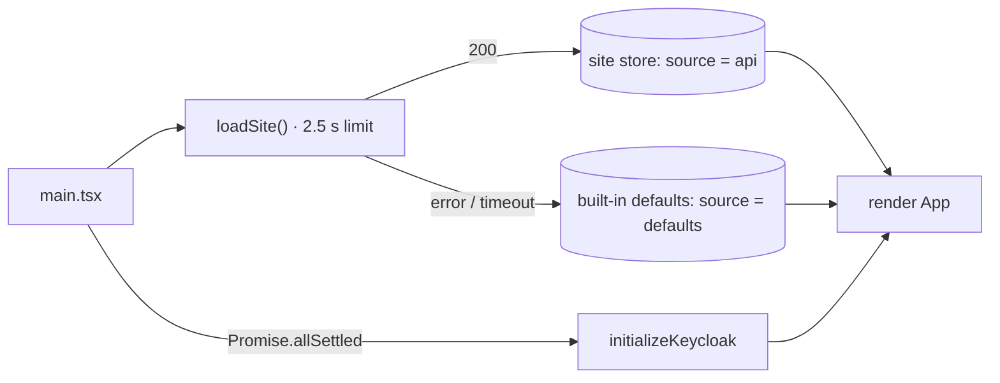
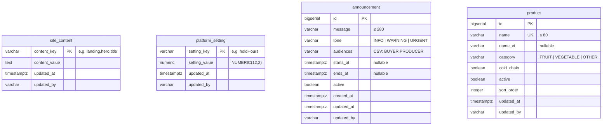

# Admin Area

How this role fits into the whole system, and the demo order for all roles: [system flow and demo script](../system/README.md).

The admin area is where an administrator changes what Farmora says and how it behaves **without a code change or a release**:

- the public landing page's text;
- system announcements;
- the operating rules that matching and the alerts use;
- the product catalog.

Unlike the role areas, which still run on demo data, the admin area is backed by the API and its own database. A saved change reaches every user.

Contents:

- [Accounts and access](#accounts-and-access)
- [What an admin can change](#what-an-admin-can-change)
- [Flow](#flow)
- [Frontend](#frontend)
- [Backend](#backend)
- [Database](#database)
- [Extending it](#extending-it)
- [Testing](#testing)
- [Troubleshooting](#troubleshooting)
- [Not done yet](#not-done-yet)

## Accounts and access

There are two different "admin" logins. They are easy to mix up.

| Account | Where | Login | Used for |
| --- | --- | --- | --- |
| Farmora admin | App, `http://localhost:5173` → `/admin` | `farmora.admin` / `Admin@123` (temporary; Keycloak asks for a new password at first login) | Site content, announcements, rules, products |
| Keycloak admin | Keycloak, `http://localhost:8081` | `admin` / `admin` (`KEYCLOAK_ADMIN`, `KEYCLOAK_ADMIN_PASSWORD` in `.env`) | Users, passwords, roles, realm settings |

- **`localhost:8081` is Keycloak, not Farmora.** Its root always redirects to `/admin/master/console/`, the master-realm console.
- Farmora's users live in the `agri-platform` realm: `http://localhost:8081/admin/agri-platform/console/`. The admin overview links straight to it.
- `ADMIN` and `COORDINATOR` cannot be picked at sign-up. Only a Keycloak admin can grant them: Users → user → Role mapping → Assign role → `ADMIN`.
- After login, an account with the `ADMIN` role lands on `/admin` (`ROLE_HOMES` in `frontend/src/lib/keycloak.ts`).
- Every `/admin` route sits inside `<RequireRole role="ADMIN">` (`App.tsx`). The API checks the role again (see [Security](#security)).

## What an admin can change

| Page | Route | Changes | Where it shows |
| --- | --- | --- | --- |
| Overview | `/admin` | Nothing (it reports: API status, what differs from the defaults, platform figures, link to Keycloak) | — |
| Site content | `/admin/content` | Titles, texts and button labels of the landing page, grouped as on the page | Landing page |
| Announcements | `/admin/announcements` | Banners with a message, tone (information, warning, urgent), audiences and an optional start and end | Top of the producer, buyer, coordinator and logistics areas; floating at the bottom of the public site |
| Operating rules | `/admin/rules` | Thresholds used by matching, holds, alerts and the cold chain | Coordinator matching, holds, alerts and Needs action; delivery temperature |
| Products | `/admin/products` | The catalog: English and Vietnamese name, category, cold chain, sort order, available or off | Product dropdowns for buyers and producers; sheet imports |

### Operating rules

| Key | Rule | Default | Allowed | Used by |
| --- | --- | --- | --- | --- |
| `autoMatchMinScore` | Auto-match score | 75 % | 50–100 | Matches below it wait for a coordinator |
| `signOffKg` | Sign-off quantity | 3,000 kg | 100–100,000 | Holds this large wait for a coordinator |
| `holdHours` | Hold length | 24 h | 1–168 | Time a producer has to confirm a hold |
| `holdWarningHours` | Hold warning | 6 h | 1–48 | "Hold expiring" alerts and Needs action. Must be shorter than the hold length. |
| `dueSoonDays` | Demand due soon | 3 days | 1–30 | "Still short" alerts, Needs action, unmet demand in red |
| `sellSoonDays` | Selling soon | 3 days | 1–30 | Coordinator's unsold supply |
| `coldChainMin` / `coldChainMax` | Cold chain min / max | 2 / 8 °C | −10–15 / 0–25 | Delivery temperature. The minimum must be below the maximum. |

## Flow

### Admin journey

1. Run `docker compose up -d`, start the API (`mvn spring-boot:run` in `backend/`) and start the frontend (`npm run dev` in `frontend/`).
2. Open `http://localhost:5173` and sign in as `farmora.admin`. The first time, Keycloak asks for a new password. Afterwards you land on **Overview**.
3. Overview shows whether the API is reachable and how many texts and rules differ from the default.
4. Edit a page:
   - **Site content / Operating rules.** Change fields. A bar at the bottom counts unsaved changes and offers **Discard** or **Save changes**. Each changed field is marked and has **Default** to go back. On save, the bar shows "Saved".
   - **Announcements.** Fill in the form; the preview shows the banner as users will see it. **Publish** adds it to the list as *Live*, *Starts …* (scheduled), *Ended* or *Off*. From the list you can edit, turn off or delete it.
   - **Products.** Add a row or edit one inline, then save. Products are switched **off** rather than deleted, so past batches and demands keep their name.
5. Check the result:
   - Open the landing page (**Open the landing page** at the top of Site content) to see new text.
   - Sign in as another role to see the announcement banner, or a new product in "Post demand" / "Declare batch".
6. When the API is down, every admin page says so and saving is disabled. The sidebar bell shows the same warning.

### How a change reaches users



Other users get a change the next time they load the app. Nothing is pushed live to open tabs. The admin's own tab updates straight away, because each save also writes the server's answer into the frontend store.

### Start-up of every page load



Loading the site never blocks the app for long and never breaks it. Without the API, everything uses the same defaults the code had before the admin area existed.

## Frontend

### Files

| Path | Purpose |
| --- | --- |
| `src/lib/api.ts` | `apiBaseUrl` (`VITE_API_URL`, default `http://localhost:8082`), `getPublic` (no token), `apiJson` (Bearer token from Keycloak), `ApiError` carrying the server's `detail` |
| `src/lib/site.ts` | Site store: types, `DEFAULT_RULES`, `DEFAULT_PRODUCTS`, `loadSite`, `updateSite`, `getSite`, `useSite`, `rule()`, `RULES` |
| `src/lib/siteContent.ts` | `CONTENT_FIELDS` (key, group, label, default text, length limit) and `useContent()` |
| `src/components/screens/LandingPage/sections/ContentText.tsx` | `Lines` / `TwoLine`: render a text whose line breaks start a new line |
| `src/components/notifications/AnnouncementBanner.tsx` | The banner (`audience`, `placement="inline" \| "floating"`); dismissed ids are kept in `localStorage` |
| `src/components/screens/Producer/sections/ProductOptions.tsx` | Product `<option>`s from the catalog (Usual / All products), used by NewDemandPage and DeclareBatchDialog |
| `src/lib/spreadsheet.ts` | Sheet import; `productName` matches catalog names in English or Vietnamese first |
| `src/components/screens/Admin/` | The admin area (below) |

### Admin screens

| File | Role |
| --- | --- |
| `AdminLayout.tsx` | Sidebar (Overview, Site content, Announcements, Operating rules, Products) and notification bell |
| `AdminHome.tsx` | API status, change counts, platform figures, Keycloak console link |
| `ContentPage.tsx` | Fields from `CONTENT_FIELDS` grouped by section, edited as a draft |
| `RulesPage.tsx` | Rule cards with unit, range and default, edited as a draft |
| `AnnouncementsPage.tsx` | Form with live preview, list with status |
| `ProductsPage.tsx` | Inline table editing; turn on/off |
| `data/adminApi.ts` | Every `/api/admin` call. After each save it calls `updateSite(...)` with the server's answer. |
| `data/useJustSaved.ts` | Short "Saved" state on a timer (avoids setState in an effect) |
| `sections/SaveBar.tsx` | Sticky draft bar: count, Discard, Save changes |
| `styles/Admin.css` | `ad-*` classes, on top of the shared area styles |

### The site store

`site.ts` is a small module-level store, with no Redux or context:

```ts
let state: SiteState = { content: {}, rules: DEFAULT_RULES, products: DEFAULT_PRODUCTS, announcements: [], source: "defaults" };

updateSite(change)   // merge + notify listeners
useSite()            // useSyncExternalStore → re-renders on change (components)
rule("holdHours")    // current value, falls back to the default (plain logic)
RULES.holdHours      // same, as a getter, read at the moment it is used
```

Which reader to use:

| Need | Use |
| --- | --- |
| Page text in a component | `const c = useContent(); c["landing.hero.title"]` (override, or the default from `CONTENT_FIELDS`) |
| A threshold in logic (matching, alerts, holds, deliveries) | `RULES.signOffKg` etc. Because they are getters, a module constant must not copy the value at import time. |
| Products, announcements, `source` | `useSite()` |
| Temperature band | `TEMPERATURE_RANGE` (getters over `RULES.coldChainMin/Max`) |

`rules` in the response are `NUMERIC` and may arrive as strings; `normalizeRules` turns them into numbers.

## Backend

Spring Boot 3.5 (Java 21) is an OAuth2 resource server. It validates Keycloak JWTs; `KeycloakRoleConverter` maps realm roles to `ROLE_*`. The code is in `backend/src/main/java/com/agrisupply/platform/`.

```
controller/  PublicSiteController   GET  /api/public/site
             AdminSiteController    /api/admin/**   @PreAuthorize("hasRole('ADMIN')")
service/     SiteContentService · PlatformRuleService · AnnouncementService · ProductService
domain/      SiteContentEntry · Announcement (+ AnnouncementTone, Audience, AudienceSetConverter)
             PlatformSetting · PlatformRule (enum: key, label, unit, default, min, max)
             Product (+ ProductCategory)
repository/  Spring Data JPA, one per entity
dto/         SiteDtos: SiteBundle, RuleView, ProductView, AnnouncementView, *Update, *Request
```

### API

| Method | Path | Who | Body / result |
| --- | --- | --- | --- |
| GET | `/api/public/site` | Anyone | `SiteBundle`: `content` overrides, all `rules` (value, default, min, max, label, unit), **active** `products`, **live** `announcements`, `contentUpdatedAt` |
| PUT | `/api/admin/content` | ADMIN | `{ "values": { "landing.hero.title": "…", "landing.cta.title": null } }` → all overrides |
| PUT | `/api/admin/rules` | ADMIN | `{ "values": { "holdHours": 12, "signOffKg": null } }` → all rules |
| GET / POST | `/api/admin/announcements` | ADMIN | All announcements (newest change first) / create → `201` |
| PUT / DELETE | `/api/admin/announcements/{id}` | ADMIN | Update / delete → `204` |
| GET / POST | `/api/admin/products` | ADMIN | All products, including switched-off / create → `201` |
| PUT | `/api/admin/products/{id}` | ADMIN | Update (switching off is `active: false`) |

Example announcement body:

```json
{ "message": "Maintenance tonight 22:00–23:00", "tone": "WARNING",
  "audiences": ["PRODUCER", "BUYER"], "startsAt": "2026-10-16T15:00:00Z", "endsAt": null, "active": true }
```

### Security

- `SecurityConfig`:
  - `GET /api/public/**` is open to everyone.
  - `/api/admin/**` requires `hasRole("ADMIN")`.
  - Every other `/api/**` needs a valid token.
- `AdminSiteController` repeats the ADMIN check with `@PreAuthorize`, so the rule survives a change to the URL rules.
- Status codes: no token → `401`; a token without ADMIN (for example COORDINATOR) → `403`.
- CORS allows `app.cors.allowed-origin` (default `http://localhost:5173`).
- `updated_by` is filled from `Authentication.getName()`: the JWT subject (Keycloak user id).

### Rules the services enforce

| Service | Checks | Notes |
| --- | --- | --- |
| `SiteContentService` | Key matches `^[a-z][a-zA-Z0-9.]{1,99}$`; value ≤ 2,000 characters | `null` or blank deletes the override (back to the default); values are trimmed |
| `PlatformRuleService` | Known key; value inside `[min, max]`; `coldChainMin < coldChainMax`; `holdWarningHours < holdHours` | Cross-checks run on the *resulting* set (stored values + this request). A value equal to the default deletes the row. |
| `AnnouncementService` | Message 1–280 characters; at least one audience; end after start | `live` = active and now in `[startsAt, endsAt)`, with an empty bound meaning open |
| `ProductService` | Name 1–80 characters, unique ignoring case → `409`; sort order 0–100,000 | No delete endpoint, only `active: false`; blank Vietnamese name is stored as `null` |

Field checks use Bean Validation on the DTO records (`@NotBlank`, `@Size`, `@NotEmpty`, …). Business checks throw `ResponseStatusException`. With `spring.mvc.problemdetails.enabled: true`, every error comes back as RFC 7807 problem details:

```json
{ "status": 400, "title": "Bad Request", "detail": "Hold length must be between 1 and 168 h" }
```

The frontend's `ApiError` shows `detail` on the admin page.

### Configuration (`application.yml`)

| Property | Value |
| --- | --- |
| `spring.datasource.url` | `${APP_DB_URL:jdbc:postgresql://localhost:5433/farmora}` |
| `spring.datasource.username` / `password` | `${APP_DB_USER:farmora}` / `${APP_DB_PASSWORD:farmora-local}` |
| `spring.jpa.hibernate.ddl-auto` | `validate`: Hibernate only checks entities against the schema; Flyway owns the schema |
| `spring.jpa.open-in-view` | `false` |
| `spring.flyway.enabled` | `true`; migrations in `src/main/resources/db/migration/` |

Dependencies added to `pom.xml`: `spring-boot-starter-data-jpa`, `flyway-core`, `flyway-database-postgresql`, `postgresql` (runtime), `spring-security-test` (test).

## Database

The API has its **own** PostgreSQL, separate from Keycloak's:

- service `app-db` in `compose.yml` (`postgres:16-alpine`);
- host port `5433`, database `farmora`, user `farmora`, password `farmora-local`;
- volume `app-db-data`.

Flyway applies `V1__site_configuration.sql` on first start: it creates the four tables and seeds 11 products.



The tables are independent and have no foreign keys.

### Design choices

- **Only overrides are stored** in `site_content` and `platform_setting`. The defaults live in code: page text in `CONTENT_FIELDS` (frontend), rules in `PlatformRule` (backend, mirrored in `DEFAULT_RULES`). An empty table therefore means "everything is the default". "Restore default" is a row delete, and a release can improve a default text without a migration.
- **Audiences are a CSV column.** `AudienceSetConverter` turns `Set<Audience>` into sorted, comma-separated names and back. There are only five values and the API never queries by audience, so a join table is not needed.
- **Products are never deleted.** Batches and demands refer to products by name, so switching a product off keeps old records readable. The public bundle returns only active products; `/api/admin/products` returns all of them.
- **`updated_by` / `updated_at` on every row** record who changed what last. There is no history table yet.

Look at the data:

```bash
docker compose exec app-db psql -U farmora -d farmora -c "select * from platform_setting;"
docker compose exec app-db psql -U farmora -d farmora -c "select id, message, tone, audiences, active from announcement;"
```

`docker compose down -v` deletes the volume. The next API start recreates the tables and the seed products.

## Extending it

| To add | Do |
| --- | --- |
| An editable text | Add a field to `CONTENT_FIELDS` and read it with `useContent()` where it renders. No backend change is needed; any key matching the pattern is stored. |
| A rule | Add it to `PlatformRule` (backend) and to `RuleKey`, `DEFAULT_RULES` and `RULES` (frontend). Use `RULES.newKey` in the logic. Add a cross-check in `PlatformRuleService` if it depends on another rule. |
| A column or table | Write a new migration `V2__….sql`. Never edit `V1`: Flyway checksums applied files. Then update the entity; `ddl-auto: validate` fails at start-up if they disagree. |
| An announcement audience | Add it to `Audience` (Java), the `Audience` type and `AUDIENCE_LABEL` (frontend), and place `<AnnouncementBanner audience="…" />` in that area's layout. |

## Testing

```bash
cd backend && mvn test
```

There are 11 tests:

- `SiteControllerSecurityTest` (WebMvcTest): anonymous `/api/admin/*` → 401, COORDINATOR → 403, ADMIN → 200, `/api/public/site` open.
- `PlatformRuleServiceTest`: ranges, both cross-checks, default value deletes the override.

Manual check:

```bash
curl http://localhost:8082/api/public/site          # 8 rules, 11 products
curl -i -X PUT http://localhost:8082/api/admin/rules # 401 without a token
```

## Troubleshooting

| Symptom | Cause / fix |
| --- | --- |
| `localhost:8081` always opens `/admin/master/console/` | That is Keycloak's own console; it is normal. The app is `http://localhost:5173`. |
| Admin pages say "API not reachable", saving disabled | The API is not running on 8082. Start `mvn spring-boot:run` in `backend/`. |
| The API fails at start with a connection error to 5433 | `app-db` is not up: run `docker compose up -d app-db`. |
| The API fails with a schema-validation or Flyway checksum error | An entity and the migrations disagree, or an applied migration was edited. Add a new `V*` file instead; locally, `docker compose down -v` resets the data. |
| Saving returns "Your account is not allowed to do this" (403) | The user lacks the `ADMIN` realm role. Assign it in the `agri-platform` realm, then sign out and back in so the token carries it. |
| Other users do not see the change | They need to reload the page; the configuration is loaded once at start-up. |
| Landing text did not change but the save worked | The section may not read that key yet. Check it uses `useContent()`. |

## Not done yet

- History and undo of past versions; only the last change and who made it are kept.
- Live push of changes to open tabs; users see a change on their next page load.
- Editable text in the role areas; only the landing page is editable today.
- The role areas still run on demo data; only the site configuration is in the database.
