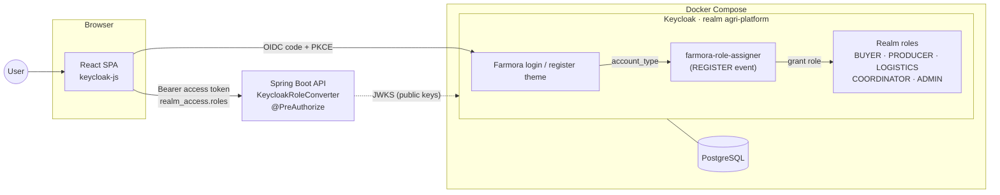
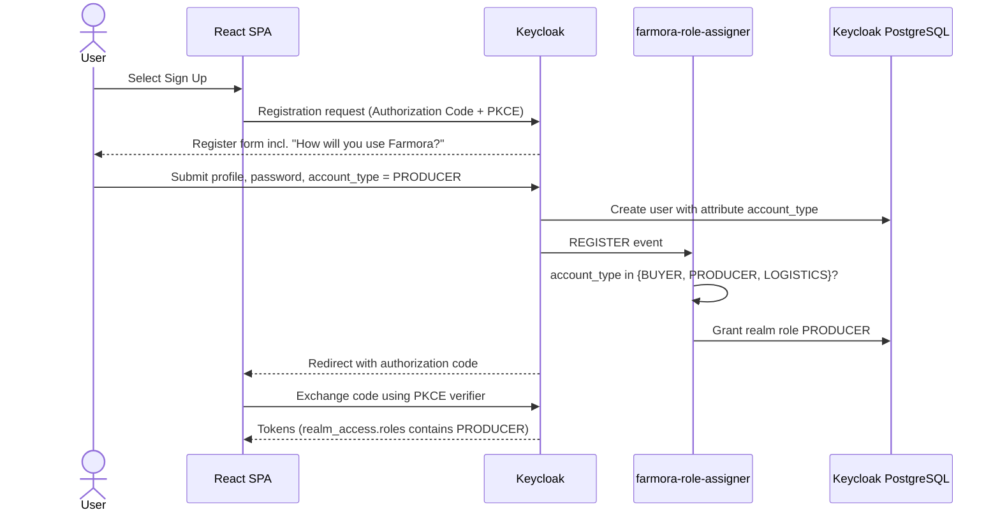
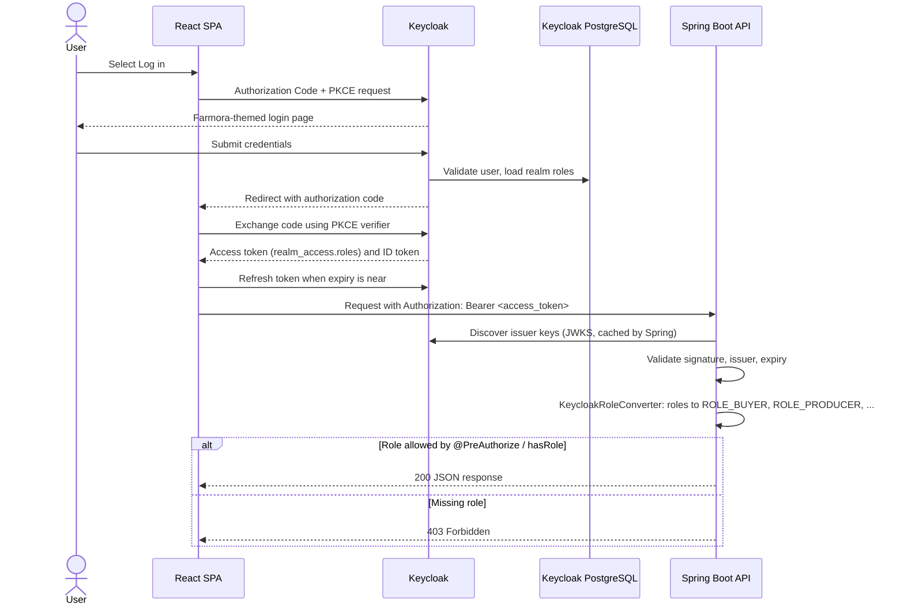

# Authentication Architecture

This document describes the current local authentication integration. Keycloak owns user identity and credentials; the React app is an OAuth public client; Spring Boot is an OAuth2 resource server.

## Components

| Component | Responsibility | Local address/config |
| --- | --- | --- |
| React + Vite | Landing page, starts login/register, holds the browser session, calls the API | `http://localhost:5173` |
| `keycloak-js` | OIDC Authorization Code flow with PKCE, callback processing, token refresh, logout | `frontend/src/lib/keycloak.ts` |
| Keycloak | Login, registration, password reset, user identity, `account_type` profile field, realm roles | `http://localhost:8081`, realm `agri-platform`, client `farmora-web` |
| `farmora-role-assigner` | Keycloak event listener: grants the realm role matching `account_type` on registration | `docker/keycloak/extensions/role-assigner` |
| PostgreSQL | Persistent storage for Keycloak realms, clients, users, roles, and credentials | Compose-only service; not published to the host |
| Spring Boot | REST API, JWT validation, maps `realm_access.roles` to `ROLE_*` authorities | `http://localhost:8082` |

## Overview



How the pieces fit together:

- **The SPA never handles passwords.** It only redirects the browser to Keycloak and receives tokens back through the OIDC Authorization Code flow with PKCE.
- **Keycloak is the single source of truth for identity and roles.** Users, credentials, the `account_type` attribute, and role assignments all live in the Keycloak PostgreSQL database. The application has no user table yet.
- **Roles are assigned inside Keycloak**, either automatically by `farmora-role-assigner` at registration or manually by an admin. Neither the SPA nor the API can grant roles.
- **The API trusts only the signed access token.** It verifies the token with Keycloak's public keys (JWKS) and reads the roles from `realm_access.roles`. It does not call Keycloak on every request; Spring caches the keys.

## Registration and automatic role



Step by step:

1. **Sign Up** in the SPA calls `keycloak.register()`, which redirects the browser to Keycloak's registration page with a PKCE challenge.
2. Keycloak renders the Farmora-themed form. Besides the standard fields, it shows the required `account_type` radio group (Buyer / Producer / Logistics) defined in `docker/keycloak/user-profile.json`.
3. On submit, Keycloak validates the input (the value must be one of the three options), creates the user, and stores `account_type` as a user attribute.
4. Keycloak fires a `REGISTER` event. The `farmora-role-assigner` listener reads `account_type` and, if it is `BUYER`, `PRODUCER`, or `LOGISTICS`, grants the realm role with the same name. Any other value is logged and ignored, so `ADMIN` and `COORDINATOR` can never be self-assigned.
5. Keycloak redirects back to `http://localhost:5173/` with an authorization code. `keycloak-js` exchanges it for tokens using the PKCE verifier.
6. Because the role was granted before the tokens were issued, the very first access token already contains the role. The user is signed in immediately and can call role-protected APIs.

## Login and authorized API request



Step by step:

1. **Log in** calls `keycloak.login()` and redirects to the Keycloak login page. On page load the SPA also runs `check-sso`, so a user who already has a Keycloak session is signed in silently without seeing the form.
2. Keycloak checks the credentials against its database and loads the user's realm roles.
3. The browser returns to the SPA with an authorization code, which `keycloak-js` exchanges for an access token and an ID token. The access token carries `realm_access.roles`, for example `["BUYER", "default-roles-agri-platform", ...]`.
4. Before each API call, `apiFetch()` asks `keycloak-js` for a token that is valid for at least 30 more seconds, refreshing it if needed, and sends it as `Authorization: Bearer <token>`.
5. Spring Boot validates the token's signature (using cached JWKS keys), issuer, and expiry. An invalid or missing token on `/api/**` returns **401 Unauthorized**.
6. `KeycloakRoleConverter` turns each realm role into a Spring authority (`BUYER` becomes `ROLE_BUYER`).
7. `@PreAuthorize("hasRole('...')")` or a `hasRole(...)` URL rule decides access: the request proceeds with **200** if the role is present, otherwise Spring returns **403 Forbidden**.

Role changes made in Keycloak take effect when the user gets a new access token (next login or token refresh); existing tokens keep their old roles until they expire.

The frontend initializes Keycloak once in `frontend/src/main.tsx` using `check-sso` and PKCE `S256`. Login and registration buttons call `keycloak.login()` and `keycloak.register()`; Keycloak returns the browser to `http://localhost:5173/`. The SPA does not collect or send passwords to Spring Boot.

`frontend/src/lib/api.ts` provides `apiFetch()`. It obtains a token through `getAccessToken()`, refreshes it when it has less than 30 seconds remaining, and adds the Bearer header. Authenticated API calls should use this helper rather than raw `fetch`.

## Registration and account type

Keycloak registration collects username, password, email, first name, last name, and the required `account_type` choice:

- `BUYER`
- `PRODUCER`
- `LOGISTICS`

The choices are a Keycloak User Profile attribute, configured in `docker/keycloak/user-profile.json`. They are user-category metadata, not Keycloak permissions. The profile file is separate from the realm-import directory and must be applied once to each realm; see [local setup](../setup/README.md).

The `account-type-claim` mapper copies `account_type` into the tokens as information only. It is never used for authorization because users can edit their own profile attributes.

## Authorization: Keycloak realm roles

Permissions come from realm roles in the `agri-platform` realm (not `master`): `BUYER`, `PRODUCER`, `LOGISTICS`, `COORDINATOR`, `ADMIN`. They are declared in `docker/keycloak/realms/agri-platform-realm.json`; on an existing database create them under **agri-platform → Realm roles**.

Keycloak puts a user's realm roles in the access token claim `realm_access.roles`. `KeycloakRoleConverter` maps each one to a Spring authority `ROLE_<name>`, so controllers use:

```java
@PreAuthorize("hasRole('PRODUCER')")
```

or URL rules in `SecurityConfig` such as `.requestMatchers("/api/producer/**").hasRole("PRODUCER")`. The frontend can call `hasRole("BUYER")` from `frontend/src/lib/keycloak.ts` to show or hide UI, but only the backend check is a security boundary.

### Automatic role at registration

The custom event listener `farmora-role-assigner` (`docker/keycloak/extensions/role-assigner`) runs on Keycloak `REGISTER` events. It reads the `account_type` chosen on the form and grants the realm role with the same name. Only `BUYER`, `PRODUCER`, and `LOGISTICS` can be self-assigned; `COORDINATOR` and `ADMIN` are granted by an admin. The role is granted once, so editing `account_type` later does not change permissions.

The listener is packaged into the Keycloak image by `docker/keycloak/Dockerfile` (`docker compose build keycloak`) and enabled by `eventsListeners` in the realm import. On an existing realm, enable it once:

```powershell
docker compose exec keycloak /opt/keycloak/bin/kcadm.sh update realms/agri-platform -s 'eventsListeners=["jboss-logging","farmora-role-assigner"]'
```

From Git Bash, prefix that command with `MSYS_NO_PATHCONV=1`; Windows PowerShell 5.1 strips the inner quotes, so run it from Git Bash or the Admin Console (**Realm settings → Events → Event listeners**).

Users created in the Admin Console do not trigger `REGISTER`; assign their roles under **Users → user → Role mapping → Assign role → Filter by realm roles**. A user must log in again (or refresh the token) after a role change.

## Current API security

`backend/src/main/java/com/agrisupply/platform/config/SecurityConfig.java` configures a stateless OAuth2 resource server:

- `GET /api/health` is public.
- `/api/**` requires a valid Keycloak JWT.
- Other routes are currently permitted.
- CORS allows the configured frontend origin, defaulting to `http://localhost:5173`.
- Spring validates tokens against `KEYCLOAK_ISSUER_URI`, defaulting to `http://localhost:8081/realms/agri-platform`.

- `@EnableMethodSecurity` is on; role rules are described in the authorization section above.

## Theme and password reset

The custom theme is `docker/keycloak/themes/farmora/login`. It extends Keycloak's `keycloak.v2` theme and reuses `frontend/src/assets/logo.png` and `auth-pic.jpg` via Compose mounts. A fixed Farmora visual panel stays on the left while Keycloak's native login, registration, and password-reset forms stay on the right. Links navigate directly with no cross-page animation delay. Forgot Password uses Keycloak's native reset-credentials flow.

The reset screen can only send reset emails after SMTP is configured in the realm. Local development currently does not configure an SMTP server.

## Important files

- `frontend/src/lib/keycloak.ts`: OIDC client, login/register/logout, token refresh
- `frontend/src/lib/api.ts`: API requests with Bearer token
- `backend/src/main/resources/application.yml`: API port, issuer, and CORS origin
- `backend/src/main/java/com/agrisupply/platform/config/SecurityConfig.java`: current API access rules
- `docker/keycloak/realms/agri-platform-realm.json`: first-import realm and SPA client
- `docker/keycloak/user-profile.json`: registration profile including `account_type`
- `docker/keycloak/themes/farmora/login/`: static login/register/reset theme panel