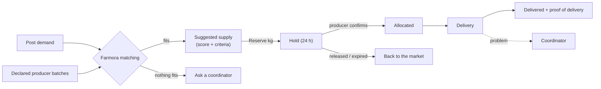
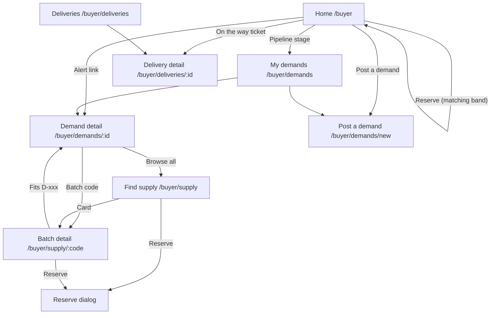
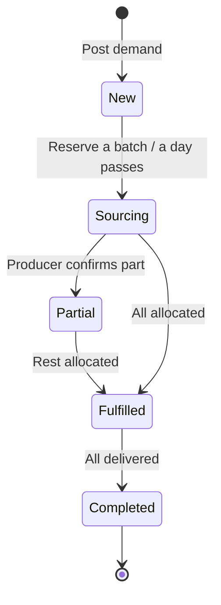
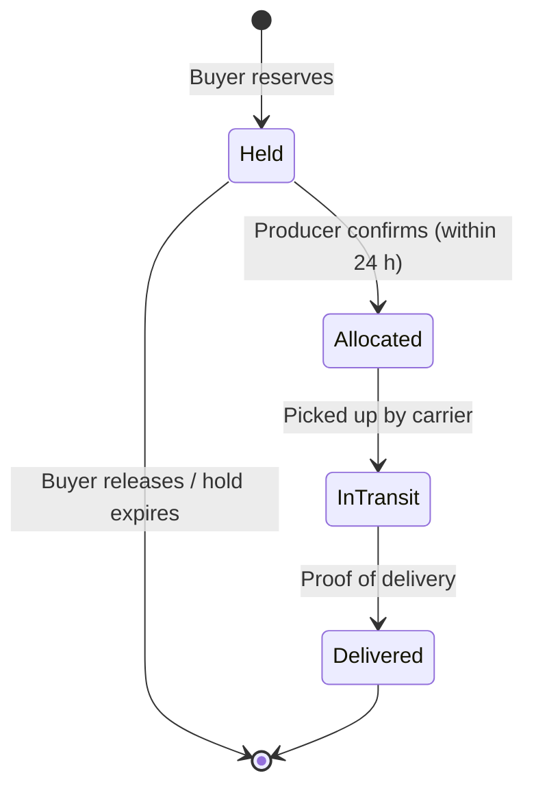

# Buyer Flow

How this role fits into the whole system, and the demo order for all roles: [system flow and demo script](../system/README.md).

Access: all `/buyer` routes require the Keycloak `BUYER` role, and buyers land on `/buyer` after login (see [auth docs](../auth/README.md#frontend-routing-by-role)).

This document describes how a buyer (supermarket, wholesaler, processor) uses Farmora: posting demands, getting system-suggested supply, reserving batches, checking producers and following deliveries. It covers the current frontend in `frontend/src/components/screens/Buyer/`.

> **Status:** UI prototype on demo data. Demands, holds, alerts and deliveries run in the browser on mock data (`data/mockBuyer.ts`); nothing is persisted and there is no backend API yet. The demo buyer is *GreenBasket Supermarkets*, which also appears as a buyer in the producer demo. The rules below are the intended behaviour the backend should take over.

## Core idea: the buyer says what they need, the system finds supply

Matching is the platform's core feature. Buyers do not search for producers and negotiate by hand:

1. The buyer **posts a demand** (product, quantity, accepted grade, needed-by date).
2. Farmora **matches** the open quantity against every declared producer batch, with the same rules and score the producer sees (see [producer docs](../producer/README.md#matching)).
3. The buyer **reserves** kilograms from a suggested batch. A reservation is a **hold**: the producer has 24 hours to confirm it.
4. The producer **confirms** and the quantity becomes **allocated**.
5. The batch is **shipped**; the buyer follows the delivery and checks the goods on arrival.

A demand can be covered by several batches from different producers. When no batch fits, the buyer can ask a coordinator to look for supply.

## Pages

| Route | Page | Purpose |
| --- | --- | --- |
| `/buyer` | Home | Matching band (most urgent demand with its best batch), deliveries on the way, this week, on the market, company card, demand pipeline. Alerts are under the bell in the top bar |
| `/buyer/demands` | My demands | All demands with how much is sourced; post a new demand |
| `/buyer/demands/new` | Post a demand | Product, quantity and grade; needed-by date; which delivery point receives it; live count of batches that fit |
| `/buyer/demands/:id` | Demand detail | Where the supply comes from, suggested batches, batches that do not fit |
| `/buyer/company` | Company | Company details and delivery points (add, edit, remove, make default) |
| `/buyer/supply` | Find supply | Market of declared batches with filters; batches that fit an open demand first |
| `/buyer/supply/:code` | Batch detail | Photos, batch facts, how it fits each open demand, producer track record, reserve |
| `/buyer/deliveries` | Deliveries | All shipments to the buyer, filtered by in transit / delivered / issues |
| `/buyer/deliveries/:id` | Delivery detail | Route map, live Cold chain block, timeline, proof of delivery, report a problem |

Query strings used by links: `/buyer/demands?status=partial` pre-filters by stage, `/buyer/supply?product=Mango` pre-selects a product, `/buyer/company?add=1` opens the new delivery point form, and `?returnTo=/buyer/demands/new` brings the buyer back to the demand they were posting. The old `/buyer/demands?new=1` link redirects to `/buyer/demands/new`.

## Home

Ordered by priority, matching first:

1. **Greeting** with a one-line summary: how many demands still need supply and how many alerts need a look; *Post a demand* button.
2. **Matching band**: the most urgent open demand that has supply, its best batch (demand ↔ score ↔ batch, criteria chips) and a *Reserve* control; other open demands below, including those with no fitting batch.
3. **Notifications** are not on the page: the bell in the top bar shows how many are open (see Alerts below).
4. **On the way to you**: shipments still travelling.
5. **This week** (`WeekAhead`): the next seven days side by side; each day lists the demands that fall due (with what is still open) and the shipments that arrive, each linking to it. Today is outlined.
6. **On the market** (`NewOnMarket`): up to four batches of the products the buyer usually orders, soonest ready first, each with the open demand it fits and its score, or "No open demand for it".
7. Side column: **company card** (default delivery point, *Edit company and delivery points*) and **demand pipeline** (count per stage, each linking to the filtered demand list).

## Demands

**Delivery points** (`/buyer/company`, from *Edit company and delivery points* on the company card): the places the buyer receives goods. Each has a name (e.g. *Thu Duc store*), street, ward, district, province, who signs for the goods and their phone, receiving hours, and optional instructions for the driver (gate, dock). Validation: name, street, district and receiver filled in, a Vietnamese phone number (10–11 digits starting with 0), hours that end after they start. The first point is the default; *Make default* moves another one to the top. The last point cannot be removed; removing one does not change demands already posted.

**Posting a demand** (`/buyer/demands/new`, a page in three numbered steps with a summary beside it; **Import from file** at the top switches to posting many at once, see below):

1. **Product**: the buyer's usual products, or **Other…** to type any product in; quantity in kg; accepted grade (Grade A, Grade A–B, Grade B, Any grade); optional notes for producers. A typed product that only differs in case from a known one is saved as that one ("mango" → "Mango"), so it still matches; a product no producer has declared posts fine and shows that no batch fits yet.
2. **When**: the needed-by date (tomorrow or later). The arrival window is the chosen point's receiving hours.
3. **Deliver to**: pick one of the saved delivery points (default selected). *Add a delivery point* and *Manage delivery points* open the company page; what was filled in is kept, and after saving a new point the buyer comes back with it selected.

The summary shows the demand as filled in so far and how many batches already fit, updated on every change. Posting saves the demand with the point's address and receiving hours and opens it.

**Importing demands** (`?mode=import`, `sections/ImportDemands.tsx`, reading in `src/lib/spreadsheet.ts`): drop an Excel (.xlsx) or CSV file, one demand per row; *Download a sample file* gives the layout. Columns are found by their header in English or Vietnamese (Product / Sản phẩm, Quantity (kg) / Số lượng, Needed by / Ngày cần, and optionally Grade / Hạng, Deliver to / Điểm giao, Notes / Ghi chú), so the buyer's own sheet works. Quantities like "1.500" or "800 kg", dates like 25/12/2026, 2026-12-25 or Excel dates, grades like "A-B" or "any", and Vietnamese product names ("Thanh long" → Dragon fruit) are understood. A preview lists every row with what was read, warnings (unknown grade, a delivery point that is not saved, so the default is used), errors (no product, quantity not a number, date in the past) and how many batches fit it now; rows with errors are left out, others can be unticked. *Post N demands* posts them in one go.

**Status is derived, never set by hand** (`fulfilmentOf` in `data/demands.ts`), from the demand's allocations:

| Status | Label | Rule |
| --- | --- | --- |
| `new` | New | Nothing reserved or allocated, posted today |
| `sourcing` | Sourcing | Only holds, or posted before today with nothing allocated |
| `partial` | Partly covered | Some quantity allocated, not all |
| `fulfilled` | Fully covered | Allocated quantity ≥ demanded quantity |
| `completed` | Completed | Delivered quantity ≥ demanded quantity |

**Open quantity** = demanded − allocated − held. It is what suggestions try to cover; a demand "needs supply" while its open quantity is above 0.

The **My demands** list has four tabs: *All*, *Needs supply* (new, sourcing and partly covered), *Fully covered*, *Completed*. Open demands come first, soonest deadline first. A pipeline link to a single stage shows as an *Only {stage}* chip that can be cleared.

**Demand detail** shows:

- the demand with a fulfilment bar (allocated, held, open);
- **Where your supply comes from**: one row per allocation (batch, producer, kg, stage); holds show the hours left and can be **released** back to the market;
- **Suggested supply**: eligible batches best first, each with score, criteria chips, *See why* (criterion-by-criterion reasons) and *Reserve*;
- batches of the same product that were considered but fail a hard rule, with the rule;
- when nothing fits, the reason (no producer has declared the product, or the closest batch and the rule it misses) and *Ask a coordinator*.

## Finding and reserving supply

**Find supply** lists batches with open quantity that are not in transit or delivered. A **search box** at the top matches product, variety, producer, region, batch code and grade (every word must match, e.g. "cat chu thuan nam"); it combines with the filters, keeps the text in the URL (`?q=`) and shows how many batches match. Filters: product, grade (A/B/C), ready window, minimum kg, and *Only batches that fit my demands*. Batches that fit an open demand come first, by score, then by ready date. Each card shows the cover photo, ready status, code and grade, open kg, sell-by date, producer with a short trust line (rating, on-time rate, verified), region and distance, and the best demand it fits.

**Batch detail** (`SupplyDetailPage`) shows the producer's photos (gallery + full-screen viewer), open kg of total, any issue the producer reported, harvest / ready / sell-by / plot, how the batch scores against each open demand of the same product, what is already reserved from it, other batches from the same producer, and the producer card.

**Reserving** (`ReserveDialog`, or the inline control on Home and demand detail): pick the demand, then the quantity, at most min(open kg of the batch, open kg of the demand). Only demands the batch is eligible for can be picked. Reserving creates a hold and takes the kilograms off the market at once. A popup confirms it right away (`ReservedNotice`, or the done step of `ReserveDialog`): how much, for which demand, from which batch and producer, the steps *Reserved → Producer confirms → Allocated*, **View order** (opens the demand at *Where your supply comes from*), **Keep browsing**, and **Undo this reservation** while the hold is unconfirmed.

Allocation stages in code: `held` (Reserved), `allocated`, `in_transit` (On the way), `delivered`. In the demo the hold countdown is static: holds do not expire and producers' confirmations are not simulated.

## Producer trust

Every batch shows who grows it and how they have delivered before (`data/producers.ts`, `sections/ProducerTrust.tsx`), next to the match score. The match score says whether the batch fits; the track record says whether it is likely to arrive as declared.

| Field | Meaning |
| --- | --- |
| Verified | Business registration checked by a Farmora coordinator |
| Rating | Average buyer rating out of 5, with the number of ratings |
| On time | Share of deliveries that arrived inside the agreed window |
| Full quantity delivered | Kilograms delivered against kilograms confirmed |
| Grade matched on arrival | Share of batches whose grade was confirmed on arrival |
| Usually confirms a hold in | Median time to confirm or decline a hold |
| Problems, last 90 days | Issues reported on the producer's batches |
| Certifications, on Farmora since | VietGAP, GlobalGAP…, and the year the producer joined |

Values below the usual level (on time < 90 %, full quantity < 95 %, grade matched < 90 %, any recent problem) are shown in amber. Recent reviews from other buyers are listed under the numbers. These figures should be computed by the backend from completed orders and buyer ratings; today they are mock data.

## Alerts

Alerts are derived from current data, not stored (`data/alerts.ts`), so they disappear once the cause is fixed. They live under the **bell** in the top bar (`NotificationBell`): a red count on the bell, and a panel that opens on click with one row per alert, urgent first. Each row is one sentence (what is wrong), one line of facts, a red or amber dot for urgency, and opens the place to fix it; rows can be dismissed. The panel closes on a click outside or Escape.

| Kind | Tone | When |
| --- | --- | --- |
| Still short | Urgent | Needed within 3 days and part of it has no supply at all ("D-565 still needs 200 kg mango") |
| Waiting for producers | Warning | Needed within 3 days, fully sourced, but part is still on hold; not shown when that hold already has a *Hold expiring* alert |
| Supply issue | Urgent | The producer reported a problem on a batch the buyer holds or has been allocated |
| Hold expiring | Warning | A hold has 6 hours or less before it lapses |
| Freshness | Warning | An allocated or held batch sells by 1 day or less after the demand's needed-by date |
| Delivery issue | Warning | A shipment has a carrier-reported issue or one the buyer reported |

## Deliveries

Same delivery views as the producer (route map with a live Cold chain block, summary panel, timeline, proof of delivery), from the receiving side. The buyer can **report a problem** (delayed, damaged, quantity mismatch, temperature, other); it goes to a coordinator and raises a delivery alert. Buyers do not see or call the driver: the panel shows the producer and carrier only, and contact goes through a coordinator.

## What other roles do

| Step | Producer | Coordinator |
| --- | --- | --- |
| Supply | Declares batches with photos, grade and dates | — |
| Hold | Confirms or declines within 24 h | Can place or release holds |
| No supply | — | Handles "Ask a coordinator" requests |
| Problems | Reports batch issues (lower yield, quality, delay) | Handles batch issues and delivery problems |

## Files

| Path | Contents |
| --- | --- |
| `BuyerLayout.tsx` | Top bar + state shared by all buyer pages (demands, supply, allocations, alerts, reported delivery issues) |
| `BuyerHome.tsx` | Home |
| `DemandsPage.tsx`, `DemandDetailPage.tsx` | Demand list and detail |
| `SupplyPage.tsx`, `SupplyDetailPage.tsx` | Market and batch detail |
| `DeliveriesPage.tsx`, `DeliveryDetailPage.tsx` | Deliveries list and detail |
| `sections/` | Building blocks (DemandHero, AlertList, AddressForm, ReserveDialog, SupplyPair, Criteria, Fulfilment, ProducerTrust, SidePanels, BuyerTopBar) |
| `data/demands.ts` | Demand status, open quantity, supply ranking (reuses `Producer/data/matching.ts`) |
| `data/alerts.ts` | Alert rules |
| `data/producers.ts` | Producer track records and reviews |
| `data/mockBuyer.ts` | Demo buyer, market batches, demands, allocations, deliveries |
| `data/buyerContext.ts` | `useBuyer()` and the shared state type |
| `styles/Buyer.css` | Buyer-only styles; the area also loads `Producer/styles/ProducerHome.css` |

## Not done yet

- Backend API and persistence for demands, holds, allocations and deliveries; matching and hold expiry should run server-side.
- Producer track records computed from real orders, and a way for buyers to rate a delivery.
- Coordinator side of "Ask a coordinator" and reported problems.
- Real batch photos (demo batches have none; producers add them when declaring a batch).
- Editing or cancelling a posted demand.
