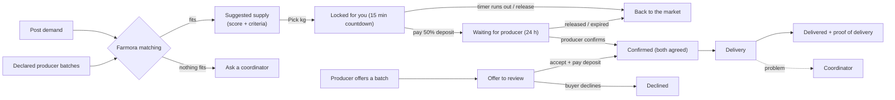
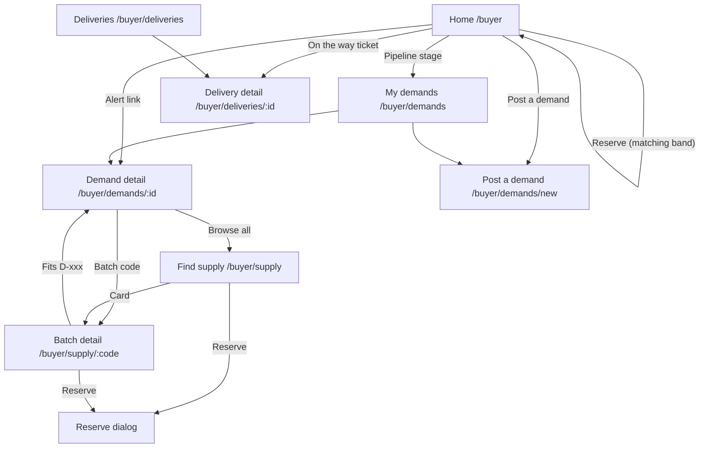
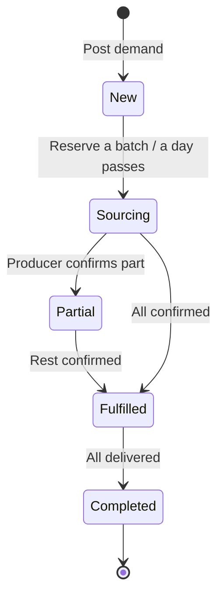

# Buyer Flow

How this role fits into the whole system, and the demo order for all roles: [system flow and demo script](../system/README.md).

Access: all `/buyer` routes require the Keycloak `BUYER` role, and buyers land on `/buyer` after login (see [auth docs](../auth/README.md#frontend-routing-by-role)).

This document describes how a buyer (supermarket, wholesaler, processor) uses Farmora: posting demands, getting system-suggested supply, reserving batches, checking producers and following deliveries. It covers the current frontend in `frontend/src/components/screens/Buyer/`.

> **Status:** UI prototype on demo data. Demands, holds, alerts and deliveries run in the browser on mock data (`data/mockBuyer.ts`); nothing is persisted and there is no backend API yet. The demo buyer is *GreenBasket Supermarkets*, which also appears as a buyer in the producer demo. The rules below are the intended behaviour the backend should take over.

## Core idea: the buyer says what they need, the system finds supply

Matching is the platform's core feature. Buyers do not search for producers and negotiate by hand:

1. The buyer **posts a demand** (product, quantity, accepted grade, needed-by date).
2. Farmora **matches** the open quantity against every declared producer batch, with the same rules and score the producer sees (see [producer docs](../producer/README.md#matching)).
3. An **order** starts one of two ways:
   - the buyer **picks** kilograms from a suggested batch. They are **locked** for 15 minutes with a live countdown, so nobody else can take them, while the buyer **pays a 50% deposit**. Paying places the order, which becomes a hold: the producer has 24 hours to confirm. If the lock runs out first, the kilograms go straight back on the market;
   - a producer **offers** one of their batches to the demand. The buyer accepts by paying the deposit, or declines.
4. Once **both sides agree** (the producer confirms the hold, or the buyer accepts the offer), the order is **confirmed**. Only confirmed kilograms count as covered.
5. Only a confirmed order is **shipped**. The buyer follows the delivery and checks the goods on arrival.

A demand can be covered by several orders from different producers. When no batch fits, the buyer can ask a coordinator to look for supply.

## Pages

The top bar has three entries: **Home**, **My demands** and **Find supply**, plus the **cart** and the bell.

- *Find supply* has two tabs: **Ready now** (`/buyer/supply`) and **Pre-harvest auctions** (`/buyer/auctions`, with the number of live auctions). The entry stays highlighted on both.
- **Deliveries** is a tab of the cart (`/buyer/orders?tab=deliveries`; the old `/buyer/deliveries` redirects there). It is also reached from *On the way to you* on Home, *Track* on an order, and delivery alerts.

| Route | Page | Purpose |
| --- | --- | --- |
| `/buyer` | Home | Matching band (most urgent demand with its best batch), deliveries on the way, this week, on the market, company card, demand pipeline. Alerts are under the bell in the top bar |
| `/buyer/demands` | My demands | All demands with how much is sourced; post a new demand |
| `/buyer/demands/new` | Post a demand | Product, quantity and grade; needed-by date; which delivery point receives it; live count of batches that fit |
| `/buyer/demands/:id` | Demand detail | Orders for this demand (offers first, with Accept / Decline), suggested batches, batches that do not fit |
| `/buyer/company` | Company | Company details and delivery points (add, edit, remove, make default) |
| `/buyer/supply` | Find supply | Market of declared batches with filters; batches that fit an open demand first |
| `/buyer/supply/:code` | Batch detail | Photos, batch facts, how it fits each open demand, producer track record, reserve |
| `/buyer/orders` | Cart | Opened from the **cart icon** next to the username. Tabs: On hold (default), Offers, Confirmed, On the way, Delivered, Declined; each order with its lifecycle |
| `/buyer/deliveries/:id` | Delivery detail | Route map, live Cold chain block, timeline, proof of delivery, report a problem |

Query strings used by links: `/buyer/demands?status=partial` pre-filters by stage, `/buyer/orders?tab=offered` opens a cart tab (and `#order-A-7` opens the tab of that order and scrolls to it), `/buyer/supply?product=Mango` pre-selects a product, `/buyer/company?add=1` opens the new delivery point form, and `?returnTo=/buyer/demands/new` brings the buyer back to the demand they were posting. The old `/buyer/demands?new=1` link redirects to `/buyer/demands/new`.

## Home

Ordered by priority, matching first:

1. **Greeting** with a one-line summary: how many demands still need supply and how many alerts need a look; *Post a demand* button.
2. **Matching band**: the most urgent open demand that has supply, its best batch (demand ↔ score ↔ batch, criteria chips) and a *Reserve* control; other open demands below, including those with no fitting batch.
3. **Notifications** are not on the page: the bell in the top bar shows how many are open (see Alerts below).
4. **On the way to you**: shipments still travelling.
5. **This week** (`WeekAhead`): the next seven days side by side; each day lists the demands that fall due (with what is still open) and the shipments that arrive, each linking to it. Today is outlined.
6. **On the market** (`NewOnMarket`): up to four batches of the products the buyer usually orders, soonest ready first, each with the open demand it fits and its score, or "No open demand for it".
7. Side column: **company card** (default delivery point, *Edit company and delivery points*) and **demand pipeline** (count per stage, each linking to the filtered demand list).

## Demands

**Delivery points** (`/buyer/company`, from *Edit company and delivery points* on the company card): the places the buyer receives goods. Each has a name (e.g. *Thu Duc store*), street, ward, district, province, who signs for the goods and their phone, receiving hours, and optional instructions for the driver (gate, dock). Validation: name, street, district and receiver filled in, a Vietnamese phone number (10–11 digits starting with 0), hours that end after they start. The first point is the default; *Make default* moves another one to the top. The last point cannot be removed; removing one does not change demands already posted.

**Posting a demand** (`/buyer/demands/new`, a page in three numbered steps with a summary beside it; **Import from file** at the top switches to posting many at once, see below):

1. **Product**: the buyer's usual products, or **Other…** to type any product in; quantity in kg; accepted grade (Grade A, Grade A–B, Grade B, Any grade); optional notes for producers. A typed product that only differs in case from a known one is saved as that one ("mango" → "Mango"), so it still matches; a product no producer has declared posts fine and shows that no batch fits yet.
2. **When**: the needed-by date (tomorrow or later). The arrival window is the chosen point's receiving hours.
3. **Deliver to**: pick one of the saved delivery points (default selected). *Add a delivery point* and *Manage delivery points* open the company page; what was filled in is kept, and after saving a new point the buyer comes back with it selected.

The summary shows the demand as filled in so far and how many batches already fit, updated on every change. Posting saves the demand with the point's address and receiving hours and opens it.

**Importing demands** (`?mode=import`, `sections/ImportDemands.tsx`, reading in `src/lib/spreadsheet.ts`): drop an Excel (.xlsx) or CSV file, one demand per row; *Download a sample file* gives the layout. Columns are found by their header in English or Vietnamese (Product / Sản phẩm, Quantity (kg) / Số lượng, Needed by / Ngày cần, and optionally Grade / Hạng, Deliver to / Điểm giao, Notes / Ghi chú), so the buyer's own sheet works. Quantities like "1.500" or "800 kg", dates like 25/12/2026, 2026-12-25 or Excel dates, grades like "A-B" or "any", and Vietnamese product names ("Thanh long" → Dragon fruit) are understood. A preview lists every row with what was read, warnings (unknown grade, a delivery point that is not saved, so the default is used), errors (no product, quantity not a number, date in the past) and how many batches fit it now; rows with errors are left out, others can be unticked. *Post N demands* posts them in one go.

**Status is derived, never set by hand** (`fulfilmentOf` in `data/demands.ts`), from the demand's allocations:

| Status | Label | Rule |
| --- | --- | --- |
| `new` | New | Nothing reserved or confirmed, posted today |
| `sourcing` | Sourcing | Only holds, or posted before today with nothing confirmed |
| `partial` | Partly covered | Some quantity confirmed, not all |
| `fulfilled` | Fully covered | Confirmed quantity ≥ demanded quantity |
| `completed` | Completed | Delivered quantity ≥ demanded quantity |

**Open quantity** = demanded − confirmed − held (offers do not count until accepted). It is what suggestions try to cover; a demand "needs supply" while its open quantity is above 0.

The **My demands** list has four tabs: *All*, *Needs supply* (new, sourcing and partly covered), *Fully covered*, *Completed*. Open demands come first, soonest deadline first. A pipeline link to a single stage shows as an *Only {stage}* chip that can be cleared.

**Demand detail** shows:

- the demand with a fulfilment bar (confirmed, reserved, open);
- **Where your supply comes from**: one row per allocation (batch, producer, kg, stage); holds show the hours left and can be **released** back to the market;
- **Suggested supply**: eligible batches best first, each with score, criteria chips, *See why* (criterion-by-criterion reasons) and *Reserve*;
- batches of the same product that were considered but fail a hard rule, with the rule;
- when nothing fits, the reason (no producer has declared the product, or the closest batch and the rule it misses) and *Ask a coordinator*.

## Finding and reserving supply

**Find supply** lists batches with open quantity that are not in transit or delivered. A **search box** at the top matches product, variety, producer, region, batch code and grade (every word must match, e.g. "cat chu thuan nam"); it combines with the filters, keeps the text in the URL (`?q=`) and shows how many batches match. Filters: product, grade (A/B/C), ready window, minimum kg, and *Only batches that fit my demands*. Batches that fit an open demand come first, by score, then by ready date. Each card shows the cover photo, ready status, code and grade, open kg, sell-by date, producer with a short trust line (rating, on-time rate, verified), region and distance, and the best demand it fits.

**Batch detail** (`SupplyDetailPage`) shows the producer's photos (gallery + full-screen viewer), open kg of total, any issue the producer reported, harvest / ready / sell-by / plot, how the batch scores against each open demand of the same product, what is already reserved from it, other batches from the same producer, and the producer card.

**Picking and locking** (`ReserveDialog` in Find supply, or the inline control on Home and demand detail): pick the demand, then the quantity, at most min(open kg of the batch, open kg of the demand). Only demands the batch is eligible for can be picked.

**Checkout lock and deposit.** Picking locks the kilograms for **15 minutes** (operating rule `lockMinutes`, editable by the admin, 1–120). This prevents overbooking: the kilograms leave the market at once, so two buyers cannot take the same quantity.

The lock is the time to **pay the deposit**: by default **50 %** of the order value, from the operating rule `depositPercent` (10–100). The popup (`ReservedNotice` with `sections/DepositPayment.tsx`) shows:

- a **live mm:ss countdown**, red in the last two minutes;
- the order value (kg × price per kg), the **deposit due now** and the balance due on delivery;
- a payment method (bank transfer via VietQR, card, MoMo e-wallet);
- **Pay** and **Release** buttons.

What happens next:

- **Pay**: after a short "Processing…" the order goes to the producer (stage `held`) with the deposit and a payment reference.
- **Release**, or the timer runs out: the kilograms go back on the market. When the timer ran out, the popup says *The lock ran out* and the bell gets a notice.

Payment is simulated: no money moves. The same countdown and **Pay deposit** button appear on the order in the cart (*On hold* tab). Accepting a producer's offer opens the same payment (**Accept & pay deposit**) and confirms the order once paid.

After paying, the popup follows the order: *Deposit paid → Producer confirms → On the way → Delivered*, with **View order**, **Keep browsing** and **Cancel this order (deposit refunded)** while the producer has not answered. Every order card shows its money line: *Deposit 11.400.000 ₫ paid · 11.400.000 ₫ on delivery*, or *Paid in full* once delivered. Market batches carry a price per kg (`pricePerKg` in `mockBuyer.ts`).

> In this demo the lock is a timer in the browser (`BuyerLayout`), so it does not protect against a buyer in another browser. On the server it would be a lock with a TTL (for example a Redis key per batch reservation with `SET … NX PX`, or a row with `expires_at` cleaned up by a job). Confirming would then turn it into a hold in one transaction.

## Orders: one lifecycle

The **cart icon** in the top bar, next to the username, opens `/buyer/orders` (`OrdersPage`). Its badge counts orders still being settled (on hold + offers) and turns red when an offer waits for an answer. The page has tabs: **On hold** (default), **Offers** (red count), **Confirmed**, **Deliveries**, **Declined**, each with one line on what it means. **Deliveries** lists the shipments of confirmed orders with route progress and arrival time, filtered by *In transit*, *Delivered* and *Issues* (`sections/DeliveriesList.tsx`); a row opens the delivery detail. `?tab=offered` opens a tab; a link to one order (`#order-A-7`) opens the tab it is in and scrolls to it. The demand detail shows the same order cards for one demand (`sections/OrderRow.tsx`).

Each order shows:

- kg and product, the batch, producer, grade and sell-by date, and the demand it is for;
- the producer's note on an offer;
- any batch issue;
- the lifecycle as four dots, *You reserved* (or *Producer offered*) → *Both agreed* → *On the way* → *Delivered*;
- who acts next ("Your answer · expires in 5 h", "Thuan Nam confirms · 4 h left", "Truck being booked");
- the action for the stage: **Accept offer** / **Decline**, **Release**, or **Track** / **Proof of delivery**.

```mermaid
stateDiagram-v2
    [*] --> Locked: Buyer picks a batch
    Locked --> Held: Buyer pays the deposit (within 15 min)
    Locked --> [*]: Timer runs out / buyer releases
    [*] --> Offered: Producer offers a batch
    Held --> Confirmed: Producer confirms (within 24 h)
    Held --> [*]: Buyer releases / hold expires
    Offered --> Confirmed: Buyer accepts and pays the deposit
    Offered --> Declined: Buyer declines
    Confirmed --> InTransit: Truck picks it up
    InTransit --> Delivered: Proof of delivery
    Delivered --> [*]
    Declined --> [*]
```

| Stage in code | Label | Counts as covered | Batch kg taken off the market |
| --- | --- | --- | --- |
| `locked` | Locked for you | No (shown as reserved) | Yes, until the lock runs out |
| `offered` | Offer to review | No | No (only after accepting) |
| `held` | Waiting for producer | No (shown as reserved) | Yes |
| `confirmed` | Confirmed | Yes | Yes |
| `in_transit` | On the way | Yes | Yes |
| `delivered` | Delivered | Yes | Yes |
| `declined` | Declined | No | No |

`data/orders.ts` holds the steps, the next-step text, the cart tabs and the sort order.

**Demo behaviour.** The areas do not share state, so a producer cannot really answer a reservation made in the buyer area. Instead the producer "confirms" six seconds after a reservation. The order moves to *Confirmed*, the popup updates if it is open, and the bell gets a "… confirmed 600 kg of B-104" notice. Two offers are seeded: Lam Ha avocado for D-572 and Thuan Nam mango for D-565. Countdowns are static: holds and offers do not expire.

## Pre-harvest auctions

Shared with the producer area (`components/auction/`). How a batch is handled changes with where it is in its life:

| Stage | Mechanism |
| --- | --- |
| Not harvested yet (`expected`) | **Pre-harvest auction**: buyers compete to secure it |
| Ready | Automatic matching |

**Flow**

1. The producer opens an auction from a batch that is not harvested yet (Batches → batch → *Open a pre-harvest auction*). They set:
   - the estimated yield range;
   - the opening price;
   - how long it runs (10 minutes for the demo, 1 hour or 24 hours).
2. Farmora shows a **yield confidence** score (`yieldConfidence`). It is built from how tight the estimate is, how far off the harvest is, the plot's yield history and certified practices, and it drops by 30 when the producer reports a risk. It is labelled as a decision aid, not a promise.
3. Buyers bid at `/buyer/auctions/:id`:
   - The current bid, who leads (other buyers stay anonymous) and a live countdown are shown.
   - The minimum next bid is the current bid plus the step; quick buttons offer +0, +1 and +2 steps.
   - The bid history updates live.
4. **Concurrent bids.** Every bid names the auction *version* it was made against (compare-and-set in `placeBid`). If another bid landed in between, the bid is refused with "Another buyer bid … a moment before you". Two bids can never both become the highest. On a server this is an atomic update or a lock on the auction row, with WebSocket or SSE pushing the new state.
5. When the timer ends, the highest bid wins. It becomes a **Future Supply Commitment**: the batch and price for the expected harvest, with the quantity estimated from the range. With no bids, the batch simply goes on to Ready and normal matching.
6. After harvest, the producer records the **actual quantity**. The commitment then continues as a normal order (Ready → Allocated → In transit → Delivered).
7. Before harvest, the producer can **report a risk** (storm, pest, date moved, lower yield). The auction goes *Under review* for a coordinator and its confidence drops.

Where: the **Pre-harvest auctions** tab of Find supply (`/buyer/auctions`, `AuctionsPage`, `AuctionDetailPage`): live auctions, the ones you won, and the ended ones.

**Demo behaviour.** Other buyers are simulated (`useAuctionSimulation`). They bid now and then, more often near the end, up to about 20 % over the opening price, through the same compare-and-set as a real bid. Auctions live in the browser tab, so they reset on reload. Three auctions are seeded: B-107 dragon fruit (ends about 9 minutes after opening the app), L-079 avocado and B-110 pomelo.

## Producer trust

Every batch shows who grows it and how they have delivered before (`data/producers.ts`, `sections/ProducerTrust.tsx`), next to the match score. The match score says whether the batch fits; the track record says whether it is likely to arrive as declared.

| Field | Meaning |
| --- | --- |
| Verified | Business registration checked by a Farmora coordinator |
| Rating | Average buyer rating out of 5, with the number of ratings |
| On time | Share of deliveries that arrived inside the agreed window |
| Full quantity delivered | Kilograms delivered against kilograms confirmed |
| Grade matched on arrival | Share of batches whose grade was confirmed on arrival |
| Usually confirms a hold in | Median time to confirm or decline a hold |
| Problems, last 90 days | Issues reported on the producer's batches |
| Certifications, on Farmora since | VietGAP, GlobalGAP…, and the year the producer joined |

Values below the usual level (on time < 90 %, full quantity < 95 %, grade matched < 90 %, any recent problem) are shown in amber. Recent reviews from other buyers are listed under the numbers. These figures should be computed by the backend from completed orders and buyer ratings; today they are mock data.

## Alerts

Alerts are derived from current data, not stored (`data/alerts.ts`), so they disappear once the cause is fixed. They live under the **bell** in the top bar (`NotificationBell`): a red count on the bell, and a panel that opens on click with one row per alert, urgent first. Each row is one sentence (what is wrong), one line of facts, a red or amber dot for urgency, and opens the place to fix it; rows can be dismissed. The panel closes on a click outside or Escape.

| Kind | Tone | When |
| --- | --- | --- |
| Still short | Urgent | Needed within 3 days and part of it has no supply at all ("D-565 still needs 200 kg mango") |
| Waiting for producers | Warning | Needed within 3 days, fully sourced, but part is still on hold; not shown when that hold already has a *Hold expiring* alert |
| Supply issue | Urgent | The producer reported a problem on a batch the buyer holds or has confirmed |
| Hold expiring | Warning | A hold has 6 hours or less before it lapses |
| Freshness | Warning | A confirmed or held batch sells by 1 day or less after the demand's needed-by date |
| Delivery issue | Warning | A shipment has a carrier-reported issue or one the buyer reported |
| Offer | Warning | A producer offered a batch to one of the buyer's demands; opens the offer in Orders |
| Confirmed | Info | A producer confirmed an order (in the demo, a few seconds after confirming it) |
| Lock ran out | Warning | A checkout lock ran out before the deposit was paid; the kilograms went back on the market |

## Deliveries

Same delivery views as the producer (route map with a live Cold chain block, summary panel, timeline, proof of delivery), from the receiving side. The buyer can **report a problem** (delayed, damaged, quantity mismatch, temperature, other); it goes to a coordinator and raises a delivery alert. Buyers do not see or call the driver: the panel shows the producer and carrier only, and contact goes through a coordinator.

## What other roles do

| Step | Producer | Coordinator |
| --- | --- | --- |
| Supply | Declares batches with photos, grade and dates | — |
| Hold | Confirms or declines within 24 h | Can place or release holds |
| Offer | Offers a batch to a matched demand (Producer → Matches → *Offer*) | — |
| No supply | — | Handles "Ask a coordinator" requests |
| Problems | Reports batch issues (lower yield, quality, delay) | Handles batch issues and delivery problems |

## Files

| Path | Contents |
| --- | --- |
| `BuyerLayout.tsx` | Top bar + state shared by all buyer pages (demands, supply, allocations, alerts, reported delivery issues) |
| `BuyerHome.tsx` | Home |
| `DemandsPage.tsx`, `DemandDetailPage.tsx` | Demand list and detail |
| `SupplyPage.tsx`, `SupplyDetailPage.tsx` | Market and batch detail |
| `OrdersPage.tsx` | Every order with its lifecycle |
| `DeliveriesPage.tsx`, `DeliveryDetailPage.tsx` | Deliveries list and detail |
| `sections/` | Building blocks (DemandHero, OrderRow, AddressForm, ReserveDialog, ReservedNotice, SupplyPair, Criteria, Fulfilment, ProducerTrust, SidePanels, BuyerTopBar) |
| `data/orders.ts` | Order lifecycle: steps, next step, filters, sort |
| `data/demands.ts` | Demand status, open quantity, supply ranking (reuses `Producer/data/matching.ts`) |
| `data/alerts.ts` | Alert rules |
| `data/producers.ts` | Producer track records and reviews |
| `data/mockBuyer.ts` | Demo buyer, market batches, demands, allocations, deliveries |
| `data/buyerContext.ts` | `useBuyer()` and the shared state type |
| `styles/Buyer.css` | Buyer-only styles; the area also loads `Producer/styles/ProducerHome.css` |

## Not done yet

- Backend API and persistence for demands, holds, offers, orders and deliveries; matching, hold and offer expiry should run server-side, and producers' answers should come from the producer area instead of the demo timer.
- Producer track records computed from real orders, and a way for buyers to rate a delivery.
- Coordinator side of "Ask a coordinator" and reported problems.
- Real batch photos (demo batches have none; producers add them when declaring a batch).
- Editing or cancelling a posted demand.
