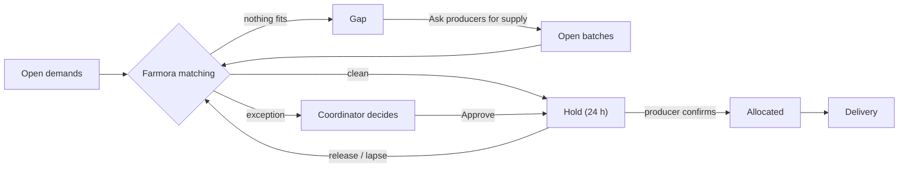
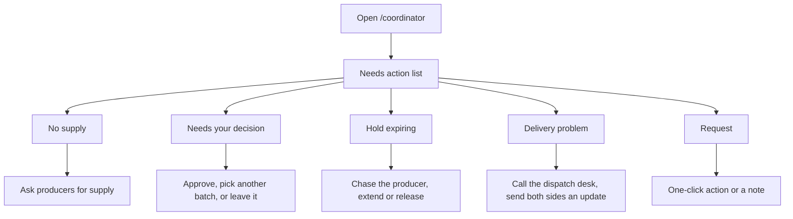

# Coordinator Flow

How this role fits into the whole system, and the demo order for all roles: [system flow and demo script](../system/README.md).

Access: all `/coordinator` routes require the Keycloak `COORDINATOR` role, and coordinators land on `/coordinator` after login (see [auth docs](../auth/README.md#frontend-routing-by-role)).

This document describes how a coordinator uses Farmora to run the whole market. It covers the current frontend in `frontend/src/components/screens/Coordinator/`.

> **Status:** UI prototype on demo data. The coordinator is not tied to a region and sees the whole market (demo coordinator *Le Thu Ha*): every buyer's demands and every producer's batches, built from the producer and buyer mock data plus a few extra records (`data/mockCoordinator.ts`). Auto-matching runs in the browser (`autoMatch` in `data/market.ts`) as a stand-in for the backend engine. Approvals, holds, resolved requests and delivery updates live in browser state only; there is no backend API yet.

## The coordinator's job

Farmora matches supply and demand on its own. The coordinator does not approve every match. They step in only where the system should not act alone:

| The system does | The coordinator does |
| --- | --- |
| Scores every open batch against every open demand | Decides the matches the system flagged as exceptions |
| Holds every clean match for the producer to confirm | Overrides a system match when it looks wrong (release) |
| Re-matches whenever something changes | Closes gaps: asks producers for supply, finds buyers for idle batches |
| Builds the **Needs action** list | Handles incidents from producers, buyers and carriers |
| Flags delivery problems and cold-chain breaks | Calls the carrier's dispatch desk and updates both sides |

Producers and buyers never contact drivers. Anything that goes wrong on the road comes to the coordinator.

## Matching flow

1. For every open demand the system scores each open batch with the same rules as the producer and buyer views (product, quantity, grade, timing, location; see [producer docs](../producer/README.md#matching)).
2. It proposes the best batch without an exception. If every eligible batch has one, it proposes the best batch overall.
3. **Clean proposal:** the system places a **hold** straight away. The producer has 24 hours to confirm. Nobody needs to approve it.
4. **Proposal with an exception:** the system stops and puts it under **Needs your decision**, with the reason.
5. **Nothing fits:** the demand is a **gap**. Batches that no demand accepts are also listed as gaps.
6. The engine runs again after every change (an approval, a release, a verified producer, a shortfall), so anything that becomes cleanly matchable is held at once. Demands are served soonest deadline first.

### When a match needs a person

Set in `data/market.ts`:

| Exception | Rule | Why a person decides |
| --- | --- | --- |
| Low score | Match score under `AUTO_MATCH_MIN_SCORE` (75%) | The fit is weak: partial quantity, little freshness left, or far away |
| Large order | The hold would be `SIGN_OFF_KG` (3,000 kg) or more | Too much value to commit without sign-off |
| Export | The buyer is an exporter | Packing and paperwork need checking |
| Producer issue | The producer reported a problem on the batch | The declared quantity or quality may not hold |
| Unverified producer | The producer's business registration is not checked yet | No verified identity behind the batch |

A hold can cover part of a demand. The rest stays open and is matched from the next batch.

## A coordinator's day

1. **Open the overview.** It shows the market map, key figures and the **Needs action** list. Clean matches never appear there.
2. **Work the list from the top.** Urgent items come first. Each row opens the page where it is handled.
3. **Glance at the rest.** The supply and demand balance shows where shortages are coming. *On the road* shows trucks, problems first. *Unsold supply* lists open kilograms nobody has bought: first every batch that must sell within 3 days (`SELL_SOON_DAYS`), whatever the reason (*No demand accepts it*, *Fits D-xxx, needs your decision*, *Fits D-xxx, not held yet*), with the sell-by date in red when it is today or tomorrow; then up to four batches no demand accepts, with a link to all of them in Gaps. Each row opens the place to act on it. *Unmet demand* is the other side: open demands no declared batch can cover, soonest first, with the kilograms still open, the needed-by date (red within 3 days), why nothing fits and **Ask producers** on the row.
4. **Check the Holds tab now and then.** It lists what the system held. Release anything that looks wrong.

### Incident flows

| Incident | Comes in as | What the coordinator does | What happens next |
| --- | --- | --- | --- |
| Producer will ship less | Supply problem request (for example R-901, P-140 short by 200 kg) | **Accept 200 kg less** | The allocation and batch shrink; matching covers the missing quantity from another batch |
| Truck breaks down | Carrier request, or a delivery problem on the list | Calls the dispatch desk from the delivery page, then **Send update** to buyer and producer | The item leaves the list once both sides are told |
| Cold chain out of range | Delivery problem (reading outside 2–8 °C) | Same as a breakdown | Same |
| Producer uploads documents | Verification request | **Verify producer** | The *unverified* exception no longer applies; their batches can be matched automatically |
| Demand with no supply | No supply item | **Ask producers for supply** | Producers are asked to declare the product; new batches are matched automatically |
| Producer slow to confirm | Hold expiring (6 h or less left) | Chases the producer, **Extend 12 h** or **Release** | A released hold goes back to matching |

## Screens

| Route | Screen | What the coordinator does |
| --- | --- | --- |
| `/coordinator` | Overview | A satellite map of the whole market (farm areas with open supply, buyer cities with open demand, trucks on the road), key figures (open supply, matched by system, needs your decision, on the road), the **Needs action** list, supply vs demand for the next 7 or 14 days, deliveries on the road, unsold supply (selling within 3 days first), unmet demand (demand no batch can cover, with *Ask producers*). A region picker focuses the map and figures on one province. |
| `/coordinator/matching` | Matching | Tabs **Needs your decision**, **Gaps**, **Holds** (`?tab=gaps`, `?tab=holds`; `?demand=D-xxx` highlights one demand) |
| `/coordinator/requests` | Requests | Open and resolved requests from producers, buyers and carriers |
| `/coordinator/deliveries` | Deliveries | All shipments on the platform, filterable by status; opens on **Issues** when there are any |
| `/coordinator/deliveries/:id` | Delivery detail | Route map, live Cold chain block in the panel, ETA, carrier, driver and dispatch desk, timeline, proof, updates to both sides |

The sidebar shows a count next to Matching (exceptions to decide), Requests (unresolved) and Deliveries (stuck shipments). A **bell** next to the brand holds the same Needs action items as notifications, so they are one click away from every page (`components/notifications/NotificationBell.tsx`, shared with the buyer and logistics areas). It has a light and dark theme, remembered per browser.

## Needs action list

The list is derived from current data (`data/queue.ts`), not stored, so it updates as soon as something is decided or resolved. Items are sorted urgent, then warning, then info:

| Item | When it appears |
| --- | --- |
| No supply | An open demand due within 3 days has no fitting batch (urgent) |
| Needs your decision | A proposal has an exception (warning when due within 3 days) |
| Hold expiring | A hold has 6 hours or less left |
| Delivery problem | An active delivery has a problem on record or cold-chain readings outside 2–8 °C, no open request covers it, and both sides have not been sent an update yet |
| Request | Any unresolved request (urgent ones first) |

On the overview panel, urgent items are listed one by one with a one-line caption. The full text is on the page each opens. Everything else is folded into one row per kind, such as "2 holds about to lapse" with the items named underneath. A kind with a single item shows that item and opens it directly.

## Matching

**Needs your decision** shows only the proposals the system would not hold on its own. Each card shows:

- **Why this needs you:** the exceptions for the batch shown;
- the demand next to the proposed batch, the match score and the criteria chips;
- the producer's rating, on-time rate and verification.

It also warns when the producer reported a problem with the batch, and when the same batch is the proposal for more than one demand. Whichever is approved first takes it, and the other demand moves to its next batch.

**Approve X kg** holds the smaller of the demand's open quantity and the batch's open quantity; anything left stays open. **Other batches** lists the alternatives with their score and lets the coordinator use one instead.

**Gaps** lists demands with no supply (with the reason and an **Ask producers for supply** action) and **unsold supply**: first every batch that must sell within 3 days, whatever the reason (no demand accepts it, or it fits a demand that needs a decision or is not held yet, with a link to that demand), then batches no demand accepts that have more time. Each shows the kilograms left, the sell-by date with the days left (red for today or tomorrow), and why nobody has bought it.

**Holds** lists every hold waiting on a producer: who made it (the system with its score, or the coordinator) and the time left. **Extend 12 h** gives the producer more time. **Release** gives the quantity back and overrides the match: that demand and batch are not paired again, and the demand moves on to its next batch.

## Requests

Requests come from producers (supply problems, finding a buyer, verification), buyers (questions about a demand) and carriers (breakdowns, late pickups). A request can link straight to the related demand, batch or delivery.

Resolving one requires a note of what was done; the note is sent to whoever raised it. Requests that need a decision rather than a note also have a one-click action that resolves them:

- **Verify producer** (verification): marks the producer as verified.
- **Accept X kg less** (supply shortfall): shrinks the allocation and the batch so matching covers the rest.

## Deliveries

Only the coordinator sees the driver, the vehicle plate and the carrier's dispatch desk number. On a delivery the coordinator can post an update, which is sent to both the producer and the buyer as a notification, for example a revised ETA after a breakdown. Sending an update clears the delivery from the Needs action list.

## Code map

| Path | Purpose |
| --- | --- |
| `CoordinatorLayout.tsx` | Owns coordinator state, runs auto-matching after each change, passes state to pages via `<Outlet context>` |
| `data/coordinatorContext.ts` | `CoordinatorState` and `useCoordinator()` |
| `data/mockCoordinator.ts` | Coordinator, combined market, demands, allocations, deliveries, requests |
| `data/market.ts` | Exception rules, auto-matching, match board, contested batches, supply without a buyer, unsold supply selling soon, supply vs demand |
| `data/queue.ts` | Builds the Needs action list, detects delivery incidents |
| `data/places.ts` | Approximate map positions for farm areas and buyer cities |
| `sections/HubMap.tsx` | Overview map |
| `sections/QueueList.tsx` | Needs action list on the overview |
| `sections/Overview.tsx` | Supply vs demand, on the road, unsold supply |
| `sections/CoordinatorSidebar.tsx` | Coordinator navigation, built on `sections/AreaSidebar.tsx` (sidebar shell shared with the logistics area) |
| `data/theme.ts` | Light/dark theme remembered per browser, shared with the logistics area |
| `CoordinatorHome.tsx`, `MatchingPage.tsx`, `RequestsPage.tsx`, `DeliveriesPage.tsx`, `DeliveryDetailPage.tsx` | Screens |
| `styles/Coordinator.css` | `co-*` styles on top of the producer and buyer styles |
| `../Producer/data/mapGeometry.ts` | Route splitting and WebGL check, shared by the delivery map and the overview map |
