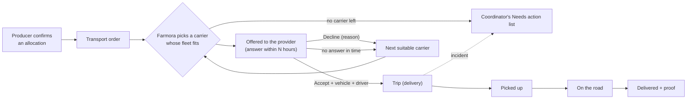

# Logistics Provider Flow

How this role fits into the whole system, and the demo order for all roles: [system flow and demo script](../system/README.md).

Access: all `/logistics` routes require the Keycloak `LOGISTICS` role, and logistics providers land on `/logistics` after login (see [auth docs](../auth/README.md#frontend-routing-by-role)).

This document describes how a logistics provider (a carrier) uses Farmora: declaring what it can carry, answering the transport orders Farmora offers, moving trips along, and reporting problems on the road. It covers the current frontend in `frontend/src/components/screens/Logistics/`.

> **Status:** UI prototype on demo data. The demo provider is *Delta Cold Chain*, the carrier on S-301, S-307, S-296 and S-288 in the producer, buyer and coordinator areas, so the same codes mean the same trips. Orders, fleet, team and trip updates live in browser state only; there is no backend API yet, so nothing a provider does here reaches the other areas.

## User stories

| Story | As a logistics provider, I want to… | Where |
| --- | --- | --- |
| US-09 | manage my account and access permissions, so that I can securely use Farmora according to my role | **Account & team** |
| US-10 | declare my transportation capacity, so that Farmora can consider suitable transportation options during coordination | **Fleet & capacity** |
| US-11 | update the status of assigned deliveries and report delivery incidents, so that Farmora can track progress and take coordination actions | **Trips** |
| — | accept or decline the transport orders Farmora offers | **Transport orders** |

## How a transport order reaches the provider

The provider never looks for loads. Farmora offers them, the same way it offers matched batches to producers:

1. When a producer confirms an allocation, Farmora creates a **transport order**: batch, quantity, product, pickup and drop-off with time windows, distance, whether it needs a cold chain, and the pay.
2. Farmora offers it to a carrier whose **declared capacity** fits (US-10). The provider has a set number of hours to answer.
3. **Accept:** pick one of the vehicles that fit and name the driver. The vehicle is booked for the trip days and the order becomes a **trip**.
4. **Decline:** give a reason (no vehicle free, outside our areas or routes, time does not work, rate too low, other). Farmora offers the order to the next suitable carrier. An order nobody answers in time goes the same way. When no carrier is left, it goes to the coordinator.
5. The provider moves the trip along and reports problems (US-11). The coordinator, not the provider, talks to the producer and buyer.

### Which vehicle fits an order

Set in `data/capacity.ts`. A vehicle fits when all of these hold:

| Rule | Example of a miss |
| --- | --- |
| Payload covers the order | "carries 1,500 kg, the order is 3,000 kg" |
| Refrigerated when the order needs a cold chain (2–8 °C) | "not refrigerated" |
| Not on another trip on any day from pickup to drop-off | "on another trip today" |
| Not marked unavailable by the provider on those days | "marked unavailable tomorrow" |

Fitting vehicles are listed smallest first, so big trucks stay free for big loads. When none fits, the order card says so and groups the vehicles by their main reason (too small, not refrigerated, on another trip, unavailable), and suggests declining. Orders that fall outside what the provider declared are still offered, with a one-line warning:

| Declared | Warning when |
| --- | --- |
| Areas | the pickup or drop-off province is not one of them |
| Routes | both provinces are served, but the pair is not a declared route (routes count in both directions) |
| Operating days | the pickup or drop-off falls on a day the company does not operate |

## Screens

| Route | Screen | What the provider does |
| --- | --- | --- |
| `/logistics` | Overview | Four figures (orders to answer and when the next lapses, trips under way and problems, delivered, free vehicles today); trips under way next to a live map of the selected trip (product, distance, due time, weight); a searchable table of every transport order with its status. The map loads lazily |
| `/logistics/orders` | Transport orders | Tabs **To answer**, **Accepted**, **Declined** (`?tab=accepted`, `?tab=declined`) |
| `/logistics/trips` | Trips | All trips, filterable: under way, problems (opens here when there are any), delivered, all |
| `/logistics/trips/:id` | Trip detail | Route map, due time, vehicle and driver, Farmora coordination desk; tabs **Update status**, **Incidents**, **Timeline**, **Temperature**, **Proof of delivery** |
| `/logistics/fleet` | Fleet | One line of figures, vehicles with type, payload and 7-day availability, add/remove vehicles, areas and routes, operating days and hours |
| `/logistics/account` | Account & team | Company details, own sign-in and security, team members, roles and permissions |

The sidebar shows a count next to Transport orders (waiting for an answer) and Trips (trips with an open problem).

## Transport orders

Each order card shows the route, who it is from and for, the pay and the hours left to answer (red at 6 hours or less), then one row of facts: load (with a snowflake when it needs a cold chain), pickup, drop-off, distance. A note from Farmora, and a one-line warning when no vehicle fits or a stop is outside the service areas, follow when they apply.

- **Accept** shows a vehicle picker (only vehicles that fit) and a driver field, filled with the vehicle's default driver. Confirming creates the trip (`S-…`), books the vehicle on the trip days and links to the trip.
- **Decline** shows a reason picker, with a sensible default (no vehicle free when nothing fits, outside our areas or routes when that applies, time does not work for an operating-day warning), and an optional note for Farmora.

## Trips

A trip follows the shared delivery steps: Packed → Picked up → On the road → Delivered. The **Update status** tab always shows the one next action:

| Current step | Action | What it records |
| --- | --- | --- |
| Packed (assigned) | **Picked up** | Time and place of loading, optional note (crates, seal, reefer setting) |
| Picked up | **On the road** | Departure; the buyer sees the truck on the map from here |
| On the road | **Mark delivered** | Who received the goods and how many kilograms they signed for (required), optional note; becomes the proof of delivery |

**Report an incident** (Incidents tab): type (vehicle breakdown, running late, temperature out of range, accident, goods damaged, other), details (required) and, if it changes, the new arrival time. The trip is flagged on every list and map, the due time is marked *revised*, and the incident goes to the Farmora coordinator. **Back on schedule** clears it. Providers do not call producers or buyers; for anything urgent they call the Farmora coordination desk shown on the trip.

## Fleet

What the provider declares (US-10), and where each item lives on the page:

| Declares | Where |
| --- | --- |
| Number of vehicles | One row per vehicle; the title line counts them by type |
| Vehicle type: regular or refrigerated | **Type** of each vehicle (refrigerated holds 2–8 °C; cold-chain orders need one) |
| Vehicle capacity | **Payload** of each vehicle, plus the fleet total |
| Operating routes and areas | **Where you operate**: areas (provinces) and routes between them |
| Available schedules | **When you operate**: operating days and hours; per-vehicle availability in the 7-day table |

- **Figures** (under the title): number of vehicles by type, total payload, vehicles free today.
- **Vehicles and availability:** plate, type (refrigerated or regular), payload, base, default driver, and the next 7 days. A day is *free*, *on a trip* (set by Farmora when an order is accepted) or *unavailable* (set by the provider: click a free day to block it, click again to free it). A vehicle with upcoming trips cannot be removed.
- **Add vehicle:** plate (checked against the `51C-482.19` format and for duplicates), type, payload (at least 100 kg), default driver (from the team's drivers), base.
- **Where you operate:** areas are the provinces served (at least one must stay). Routes are corridors between two of those provinces, in both directions; removing an area removes its routes.
- **When you operate:** the days of the week (at least one) and the opening hours for pickups and drop-offs.

## Account & team

- **Company:** registered name, tax code, address, dispatch desk phone and email (name, phone and a valid email are required), with the *Verified* badge once Farmora has checked the business registration. Coordinators see these details; producers and buyers only see the company name.
- **Sign-in and security:** who is signed in, and a button to Keycloak's account console (`openAccountConsole()` in `frontend/src/lib/keycloak.ts`) for password, two-step login and sessions.
- **Team and permissions:** invite members by name, email and role, change roles, remove members. The company always keeps at least one owner. What each role can do (`ROLE_PERMISSIONS` in `data/mockLogistics.ts`):

| Permission | Owner | Dispatcher | Driver |
| --- | --- | --- | --- |
| Accept or decline transport orders | ✓ | ✓ | |
| Declare vehicles and capacity | ✓ | ✓ | |
| Update delivery status | ✓ | ✓ | ✓ (own trips) |
| Report incidents | ✓ | ✓ | ✓ (own trips) |
| Edit company details and team | ✓ | | |

The Keycloak `LOGISTICS` role gives access to the area; the team roles are a finer layer inside one provider account. In this prototype they are shown, not enforced; the backend will enforce both.

## Code map

| Path | Purpose |
| --- | --- |
| `LogisticsLayout.tsx` | Owns the provider's demo state (profile, team, fleet, service areas, orders, trips, incidents) and passes it to pages via `<Outlet context>` |
| `data/logisticsContext.ts` | `LogisticsState` and `useLogistics()` |
| `data/mockLogistics.ts` | Provider, team and permissions, fleet, service areas, transport orders, trips, decline reasons, incident types |
| `data/capacity.ts` | Which vehicle fits an order, area/route/operating-day warnings, day availability, VND formatting |
| `sections/OrderCard.tsx` | Transport order card with accept and decline |
| `LogisticsHome.tsx`, `OrdersPage.tsx`, `TripsPage.tsx`, `TripDetailPage.tsx`, `FleetPage.tsx`, `AccountPage.tsx` | Screens |
| `styles/Logistics.css` | `lg-*` styles on top of the producer, buyer and coordinator styles |

Pages use a short title and flat solid cards rather than the coordinator's frosted glass. The sidebar shell (`Coordinator/sections/AreaSidebar.tsx`) and the light/dark theme hook (`Coordinator/data/theme.ts`) are shared with the coordinator area. Trip maps, timelines and temperature logs reuse the producer's delivery components.
