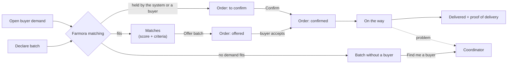
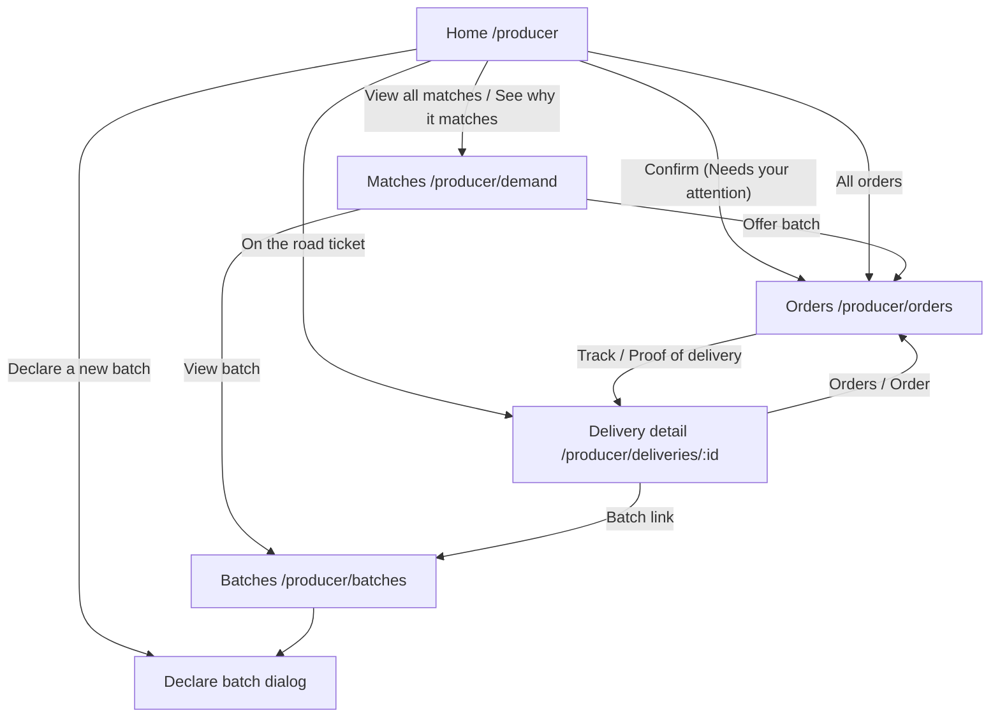
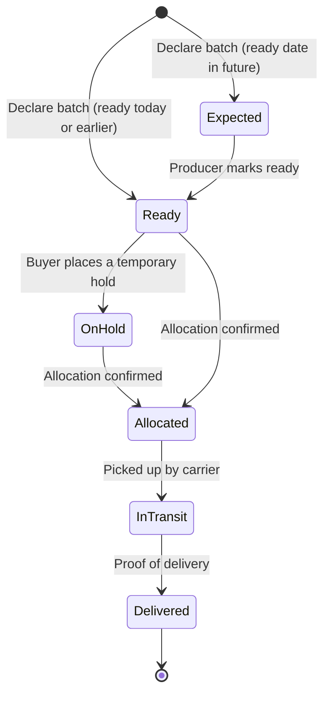
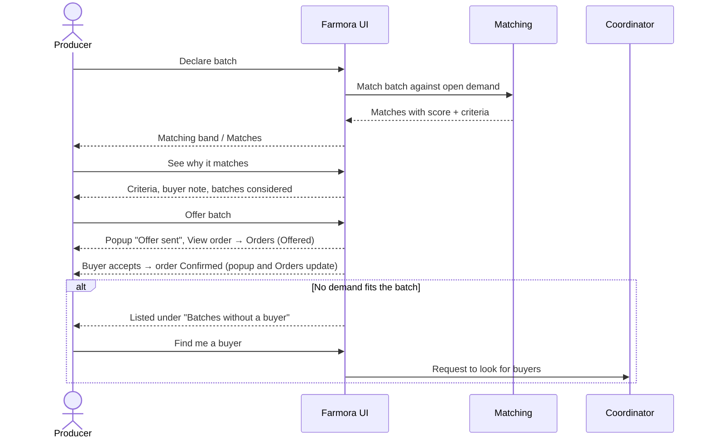
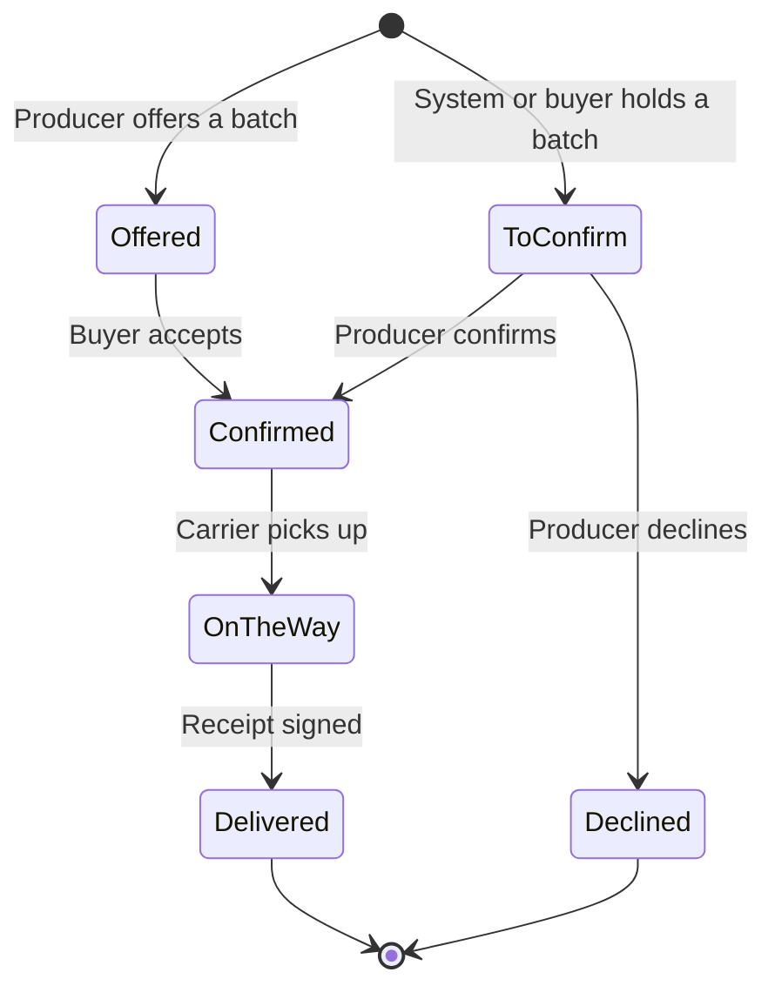
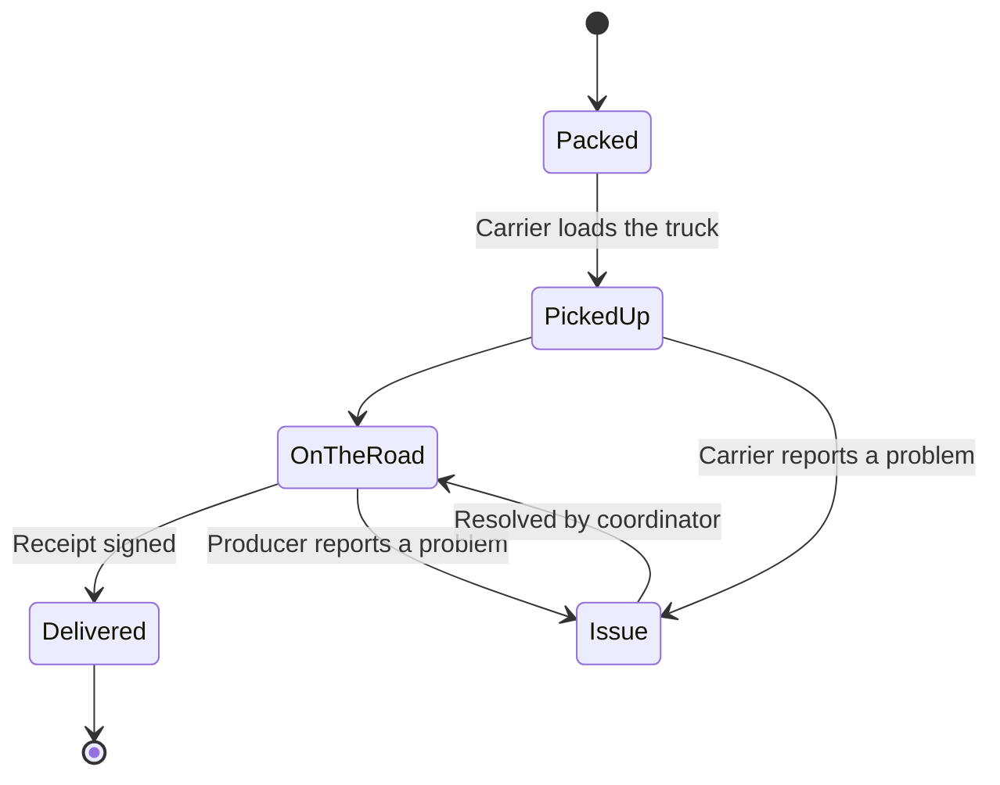

# Producer Flow

How this role fits into the whole system, and the demo order for all roles: [system flow and demo script](../system/README.md).

Access: all `/producer` routes require the Keycloak `PRODUCER` role, and producers land on `/producer` after login (see [auth docs](../auth/README.md#frontend-routing-by-role)).

This document describes how a producer (farm or cooperative) uses Farmora: declaring supply, seeing who needs it, confirming orders and following them until delivery. It covers the current frontend in `frontend/src/components/screens/Producer/`.

> **Status:** UI prototype on demo data. Matching, orders, deliveries and market insights run in the browser on mock data (`data/mockProducer.ts`, `data/orders.ts`); nothing is persisted and there is no backend API yet. The rules below are the intended behaviour the backend should take over.

## Core idea: the system matches, the producer confirms

Matching is the platform's core feature. Producers never pair supply and demand by hand:

1. The producer **declares batches** (what, how much, grade, when it is ready, when it must be sold).
2. Farmora **matches** every open buyer demand against every declared batch and explains each match criterion by criterion.
3. An **order** reaches the producer: the matching engine or a buyer holds kilograms of a batch, or the producer offers a batch to a matched demand.
4. The producer **confirms** the order within the time shown (or declines it).
5. The batch is **shipped**; the producer follows the order until proof of delivery.

Three ideas, one place each: a **batch** is what the farm has (Batches), a **match** is who needs it (Matches), an **order** is who bought it and how far it has got (Orders). A delivery is the last part of an order, followed from Orders.

Batches that no demand fits are flagged as **"Batches without a buyer"** so the producer can ask a coordinator to find one. Demands without a suitable batch are a buyer/coordinator concern and are not shown to producers.

## Pages

The top bar has four entries: **Home**, **Matches**, **Orders** (with a red count while orders wait for confirmation) and **Batches**.

| Route | Page | Purpose |
| --- | --- | --- |
| `/producer` | Home | What needs the producer today: best match, tasks, harvest calendar, trucks on the road, farm profile, AI market insights |
| `/producer/demand` | Matches | All matches as demand ↔ batch pairs, match details, offer a batch, batches without a buyer |
| `/producer/orders` | Orders | Every sale on the farm's batches, offered to delivered; confirm or decline, track the shipment, proof of delivery |
| `/producer/batches` | Batches | Planning calendar and full batch list, declare a new batch, per-batch history (matches, orders, shipments) |
| `/producer/deliveries/:id` | Delivery detail | Opened from an order: live route map with the truck's temperature, timeline, proof of delivery, report a problem |

`/producer/calendar` redirects to `/producer/batches` (query string kept), and the old `/producer/deliveries` list redirects to Orders (*Deliveries*).

## Home

Ordered by priority, matching first:

1. **Greeting** with a one-line summary (matches not yet acted on, tasks open).
2. **Matching band**: the best match not yet offered (buyer demand ↔ score ↔ batch, criteria, *Offer* button), more matches, and how many batches have no buyer.
3. **Needs your attention**: work items only. Confirm an order (most urgent; the same action as on Orders), a batch whose status should be updated.
4. **Harvest calendar**: two weeks around today; selecting a batch shows its status steps, quantities and actions inline.
5. **On the road**: shipments still travelling, as tickets (arrival time, route progress, problem if any); *All orders* opens Orders.
6. Side column: **farm profile** and **From the market** (AI insights; details open in a dialog with analysis, evidence and sources).

## Batch lifecycle

Statuses in code: `expected`, `ready`, `on_hold`, `allocated`, `in_transit`, `delivered`. A producer can advance a batch one step at a time from the batch detail, or report an issue (lower yield, quality problem, no longer available, harvest delayed), which goes to a coordinator.

**Declaring a batch** (`NewBatchPage`, route `/producer/batches/new`): product (the farm's usual products, or **Other…** to type one in; a case-only difference from a known product is saved as that product), variety, plot, quantity, grade A/B/C, expected harvest, ready-to-sell and sell-by dates, and 1–4 photos of the batch (image files up to 10 MB; the first is the cover buyers see). Validation: quantity > 0, ready ≥ harvest, sell-by > ready, at least one photo. While typing, a side column shows which open demands the batch would match (top three with their score) and the selling window; after saving, the page reports the match count with links to the batch and to Matches.

**Importing batches** (*Import from file* on the Batches page, `sections/ImportBatchesDialog.tsx`): drop an Excel (.xlsx) or CSV file, one batch per row, with Product, Variety, Quantity (kg), Harvest and Sell by, and optionally Grade (A, B, C), Plot and Ready to sell (headers in English or Vietnamese; a sample file can be downloaded). Each row is checked with the same rules as declaring one batch and shows how many demands it matches; *Declare N batches* declares the good rows. Photos are added to each batch afterwards.

## Matching

Implemented in `data/matching.ts` as a demo engine; the backend should own it so every role sees the same result.

**Hard rules** – a batch is not a match if any fails:

| Rule | Condition |
| --- | --- |
| Product | Batch product = demand product |
| Grade | Batch grade is in the demand's accepted grades (e.g. "Grade A–B") |
| Timing | Batch ready on or before the needed-by day, and still sellable on that day |
| Availability | Open quantity > 0 and the batch is not in transit or delivered |

**Score** (0–100) for eligible batches:

| Part | Weight | How |
| --- | --- | --- |
| Quantity | 30 | Share of the demanded quantity the open quantity covers |
| Grade | 25 | Full points once eligible |
| Timing / freshness | 30 | More days left before sell-by on delivery = higher |
| Location | 15 | Shorter delivery distance = higher |

Each match exposes five criteria (Product, Quantity, Grade, Timing, Location) as *pass*, *partial* (e.g. partial quantity, under 3 days of freshness, over 250 km) or *fail*, each with a plain-language reason. The best-scoring eligible batch is the suggested match; other batches considered are listed with their score or the rule they failed.

**Batches without a buyer** (`batchesWithoutBuyer`): active batches with open quantity that no demand fits. The reason is either "no buyer is asking for this product" or the closest buyer and the rule it misses.

## Orders

`/producer/orders` (`OrdersPage`, orders in `data/orders.ts`, merged in `ProducerLayout`) is the one place for every sale on the farm's batches, from the first step to delivery. The top bar shows a red count next to **Orders** while some wait for confirmation.

An order is **confirmed once both sides agree**, either way round:

- a buyer (or the matching engine) reserves a batch, the buyer pays the deposit, and the producer confirms;
- the producer offers a batch, and the buyer accepts it by paying the deposit.

Each order card says whether the buyer's deposit is paid (*… paid a 50% deposit · the rest on delivery*).

Only a confirmed order gets a truck. This is the same rule the buyer sees.

| Stage | Meaning | Action on the row |
| --- | --- | --- |
| Offered | The producer offered a batch to a matched demand; the buyer decides | — (*Buyer decides*) |
| To confirm | The matching engine or a buyer holds kilograms of a batch; the producer has a set number of hours | **Confirm** or **Decline**, with the hours left in red |
| Confirmed | Both agreed; a truck is being booked to pick up at the packhouse | — |
| On the way | Picked up; shows *Problem on the road* when the delivery has an issue | **Track S-…** (delivery detail) |
| Delivered | Receipt signed | **Proof of delivery** |
| Declined | The quantity went back to the market | — |

**Tabs**, in lifecycle order: *To confirm* (red count), *Offered*, *Confirmed*, **Deliveries**, *Declined*. Each tab has one line on what it means. **Deliveries** holds both orders on the way and delivered ones: the shipment list with route progress and arrival time, filtered by *In transit*, *Delivered* and *Issues* (`sections/DeliveriesList.tsx`). A row opens the delivery detail. `/producer/deliveries` redirects to it.

- The page opens on the first tab with something in it.
- `?tab=offered` opens a tab directly.
- A link to one order (`#order-OF-D-551`) opens its tab and scrolls to it.

**Each order is a card** (shared with the buyer area, `components/orders/`). It shows:

- kg, product and buyer;
- buyer type, batch, needed-by date and destination;
- the demand, and when it was placed or offered;
- the stage pill;
- the lifecycle as four dots, *Buyer reserved* (or *You offered*) → *Both agreed* → *On the way* → *Delivered*;
- who acts next ("Your answer · 5 h left", "GreenBasket decides", "Truck being booked");
- the action for the stage.

Confirming or declining here and on the home page's *Needs your attention* card is the same action, so both stay in sync, and confirming moves the batch to *Allocated*.

**After offering** a batch (matching band on Home, or Matches), a popup (`sections/OfferSentNotice.tsx`) shows:

- to whom and what was offered;
- the steps *You offered → Buyer accepts → On the way → Delivered*;
- **View order** and **Keep browsing**.

Where the offer was made, the line says *Offered B-104 · waiting for …* or *Accepted*, with a **View order** link.

**Demo behaviour.** The areas do not share state, so the buyer "accepts" six seconds after an offer. The order moves to *Confirmed*, the batch to *Allocated*, and the popup updates if it is open.

## Deliveries

The delivery detail page shows:

- **Route map** – MapLibre GL with the free OpenFreeMap "Positron" basemap and real road geometry (OSRM, stored in `data/routes.ts`); travelled part solid, remaining part dashed, red when the shipment has an issue.
- **Live cold chain, always in view** (`sections/LiveTemperature.tsx`, readings in `data/liveTemperature.ts`) – there is no separate temperature tab and nothing to click. The shipment panel beside the map has a **Cold chain** block: the current temperature with a *Live* marker, *Within / Outside 2–8 °C*, a small trend of recent readings over the safe band, the time of the last reading, the range so far and how many readings were out of range; it updates every few seconds. Once delivered the block says how the cold chain held over the whole trip ("Held 2–8 °C the whole trip", readings ranged 4.0–5.1 °C). The demo simulates readings from the stored ones; a sensor feed would replace `useLiveReadings`. The same map and block are used on the producer, buyer, coordinator and logistics delivery pages (`RouteMap` passes the block to the page's panel).
- **Summary panel** – estimated arrival (flagged *Revised* when changed), batch → buyer, progress steps, carrier. Producers do not see or call the driver; contact goes through a coordinator.
- **Tabs** – timeline; proof of delivery (received by, quantity received, notes); **report a problem** (delayed, damaged, quantity mismatch, temperature, other) sent to a coordinator.

## What other roles do

| Step | Buyer | Coordinator |
| --- | --- | --- |
| Demand | Creates demand (product, quantity, grade, needed-by, destination) | Sees demands no batch fits |
| Order | Reserves a batch (a hold for the producer to confirm), or accepts the producer's offer | Decides matches the system would not hold on its own; extends or releases holds |
| Problems | Checks goods on arrival | Handles batch issues, delivery problems and "find me a buyer" requests |

## Shelf life and spoilage risk

Batches are managed by **time left**, not as static stock (`components/freshness/`, shared by producer and coordinator).

- **Shelf-life bar** (`ShelfLifeBar`). It covers harvest (06:00 on the harvest day) to the end of the sell-by day, and shrinks as time passes, refreshed every 30 s.
  - Colour: green above 50 % left, amber 20–50 %, red below 20 %.
  - The time left is shown as text ("2 d 14 h left", "9 h 20 m left"); the exact sell-by time is in the tooltip.
- **Spoilage risk index** (`spoilageRisk`, 0–100). A transparent rule-based score, recomputed every 15 s and whenever the data changes. It adds up:
  - how much of the shelf life is used (up to 60);
  - the unsold share (up to 25, weighted more once a third of the shelf life is gone);
  - a cold-chain product (+6);
  - a reported temperature excursion (+45).

  Levels: *Low* below 40, *Watch* 40–69, *High* from 70. The badge's tooltip lists why. A trained model could replace the function later without changing the screens.
- **Instant alerts** (`useSpoilageAlerts`, `RiskToasts`). When an unsold batch reaches *High*, an alert appears at once, with no reload needed:
  - a floating card in the top-right corner (up to three at a time), with what, how much is unsold, the time left and the main reason, plus an action;
  - the same alert under the bell (coordinator).

  Dismissing the card keeps the alert under the bell.

**Demo behaviour.** There are no real sensors or push server. About 20 s after the area opens, a simulated cold-room reading ("cold room read 11 °C for 40 min") is reported for the unsold cold-chain batch closest to its sell-by date. That pushes its risk over 70, so the alert pops up live. With a backend this would be a WebSocket or server-sent events stream fed by the risk job and the sensors.

Where the producer sees it: **Batches**, in the table columns *Shelf life* (bar + sell-by date) and *Spoilage risk* (badge; *Sold* when nothing is open). Alerts float over every producer page, and *Find buyers* opens Matches at the batches without a buyer.

## Pre-harvest auctions

Shared with the buyer area (`components/auction/`). How a batch is handled changes with where it is in its life:

| Stage | Mechanism |
| --- | --- |
| Not harvested yet (`expected`) | **Pre-harvest auction**: buyers compete to secure it |
| Ready | Automatic matching |

**Flow**

1. The producer opens an auction on the **New auction** page (`/producer/auctions/new`, `NewAuctionPage`), reached from the *New auction* button on the Pre-harvest auctions tab or from *Open a pre-harvest auction* on a not-yet-harvested batch (which preselects it). They pick a batch that is not harvested yet and has no auction, then set:
   - the estimated yield range;
   - the opening price;
   - how long it runs (10 minutes for the demo, 1 hour or 24 hours);
   - optionally, how it is grown (VietGAP, GlobalGAP, organic, drip irrigation, bagged fruit) and last season's yield from the plot. A side column shows the yield confidence and the opening value live.
2. Farmora shows a **yield confidence** score (`yieldConfidence`). It is built from how tight the estimate is, how far off the harvest is, the plot's yield history and certified practices, and it drops by 30 when the producer reports a risk. It is labelled as a decision aid, not a promise.
3. Buyers bid at `/buyer/auctions/:id`:
   - The current bid, who leads (other buyers stay anonymous) and a live countdown are shown.
   - The minimum next bid is the current bid plus the step; quick buttons offer +0, +1 and +2 steps.
   - The bid history updates live.
4. **Concurrent bids.** Every bid names the auction *version* it was made against (compare-and-set in `placeBid`). If another bid landed in between, the bid is refused with "Another buyer bid … a moment before you". Two bids can never both become the highest. On a server this is an atomic update or a lock on the auction row, with WebSocket or SSE pushing the new state.
5. When the timer ends, the highest bid wins. It becomes a **Future Supply Commitment**: the batch and price for the expected harvest, with the quantity estimated from the range. With no bids, the batch simply goes on to Ready and normal matching.
6. After harvest, the producer records the **actual quantity**. The commitment then continues as a normal order (Ready → Allocated → In transit → Delivered).
7. Before harvest, the producer can **report a risk** (storm, pest, date moved, lower yield). The auction goes *Under review* for a coordinator and its confidence drops.

Where: the **Pre-harvest auctions** tab of Batches (`/producer/auctions`, `AuctionsPage`; *Batches* stays highlighted): the farm's auctions with bids arriving live, the commitment, *Record harvest* and *Report a risk before harvest*. On a not-yet-harvested batch in Batches: `sections/PreHarvestAuction.tsx`.

**Demo behaviour.** Other buyers are simulated (`useAuctionSimulation`). They bid now and then, more often near the end, up to about 20 % over the opening price, through the same compare-and-set as a real bid. Auctions live in the browser tab, so they reset on reload. Three auctions are seeded: B-107 dragon fruit (ends about 9 minutes after opening the app), L-079 avocado and B-110 pomelo.

## Files

| Path | Contents |
| --- | --- |
| `ProducerLayout.tsx` | Top bar + state shared by all producer pages (batches, tasks, orders including this session's offers, issues) |
| `ProducerHome.tsx` | Home |
| `MarketDemandPage.tsx` | Matches page |
| `OrdersPage.tsx`, `data/orders.ts` | Orders by stage tab, lifecycle steps, next step |
| `sections/OfferSentNotice.tsx` | Popup after offering a batch |
| `../../orders/` (`LifecycleSteps.tsx`, `orders.css`) | Lifecycle dots, order cards, tabs and popup styles shared with the buyer area |
| `BatchesPage.tsx` | Batches page |
| `DeliveryDetailPage.tsx` | Delivery detail, opened from an order |
| `sections/` | Building blocks (MatchHero, AttentionList, CalendarGrid, BatchDetail, RouteMap, LiveTemperature, MarketInsights…) |
| `data/matching.ts` | Matching rules, scores and criteria |
| `data/mockProducer.ts` | Demo batches, demands, tasks, deliveries, insights |
| `data/routes.ts` | Stored road geometry for the delivery map |
| `styles/ProducerHome.css` | Styles for the whole producer area |

## Not done yet

- Backend API and persistence for batches, demands, matches, orders and deliveries; matching should move server-side.
- Real AI insight generation and data sources (e.g. a weather API such as Open-Meteo, market price feeds).
- Live vehicle positions and sensor readings for deliveries.
- Producer profile editing.
