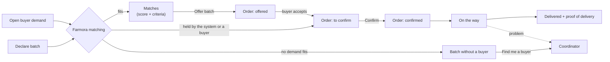
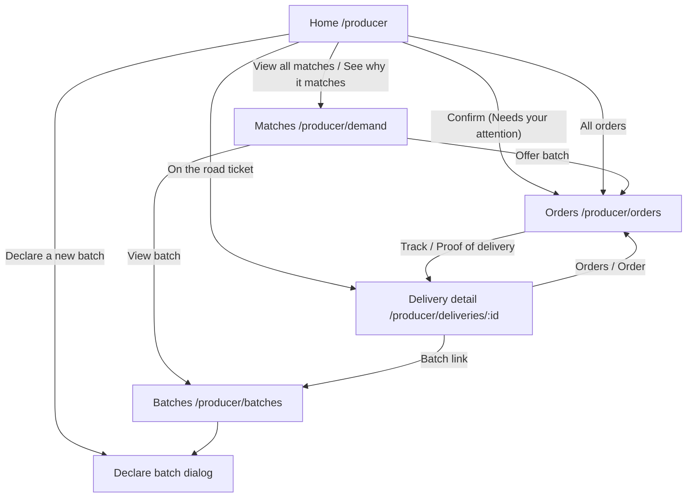
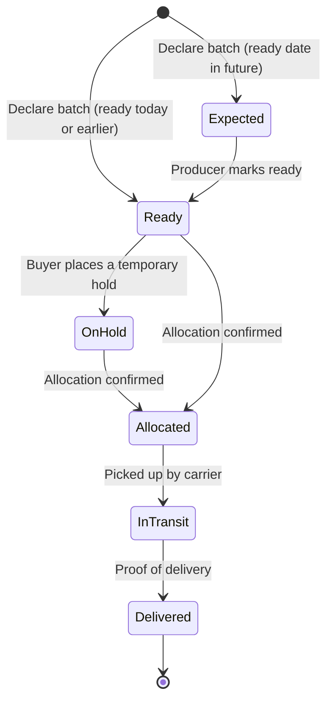
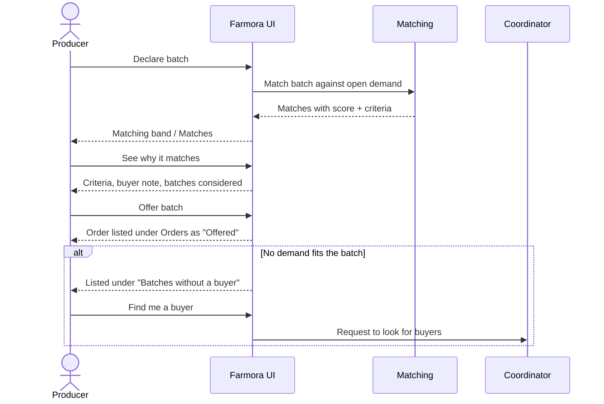
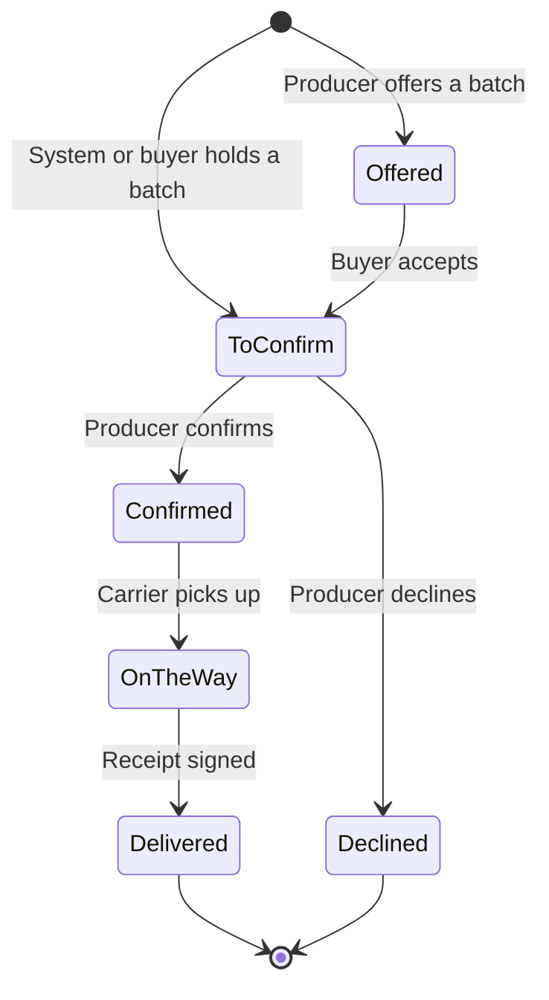
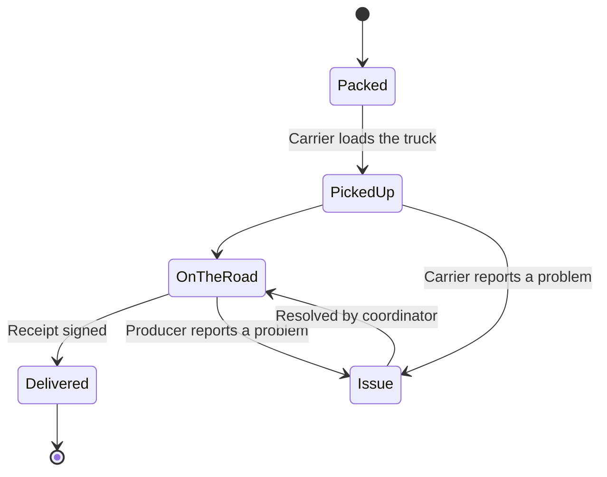

# Producer Flow

How this role fits into the whole system, and the demo order for all roles: [system flow and demo script](../system/README.md).

Access: all `/producer` routes require the Keycloak `PRODUCER` role, and producers land on `/producer` after login (see [auth docs](../auth/README.md#frontend-routing-by-role)).

This document describes how a producer (farm or cooperative) uses Farmora: declaring supply, seeing who needs it, confirming orders and following them until delivery. It covers the current frontend in `frontend/src/components/screens/Producer/`.

> **Status:** UI prototype on demo data. Matching, orders, deliveries and market insights run in the browser on mock data (`data/mockProducer.ts`, `data/orders.ts`); nothing is persisted and there is no backend API yet. The rules below are the intended behaviour the backend should take over.

## Core idea: the system matches, the producer confirms

Matching is the platform's core feature. Producers never pair supply and demand by hand:

1. The producer **declares batches** (what, how much, grade, when it is ready, when it must be sold).
2. Farmora **matches** every open buyer demand against every declared batch and explains each match criterion by criterion.
3. An **order** reaches the producer: the matching engine or a buyer holds kilograms of a batch, or the producer offers a batch to a matched demand.
4. The producer **confirms** the order within the time shown (or declines it).
5. The batch is **shipped**; the producer follows the order until proof of delivery.

Three ideas, one place each: a **batch** is what the farm has (Batches), a **match** is who needs it (Matches), an **order** is who bought it and how far it has got (Orders). A delivery is the last part of an order, followed from Orders.

Batches that no demand fits are flagged as **"Batches without a buyer"** so the producer can ask a coordinator to find one. Demands without a suitable batch are a buyer/coordinator concern and are not shown to producers.

## Pages

The top bar has four entries: **Home**, **Matches**, **Orders** (with a red count while orders wait for confirmation) and **Batches**.

| Route | Page | Purpose |
| --- | --- | --- |
| `/producer` | Home | What needs the producer today: best match, tasks, harvest calendar, trucks on the road, farm profile, AI market insights |
| `/producer/demand` | Matches | All matches as demand ↔ batch pairs, match details, offer a batch, batches without a buyer |
| `/producer/orders` | Orders | Every sale on the farm's batches, offered to delivered; confirm or decline, track the shipment, proof of delivery |
| `/producer/batches` | Batches | Planning calendar and full batch list, declare a new batch, per-batch history (matches, orders, shipments) |
| `/producer/deliveries/:id` | Delivery detail | Opened from an order: live route map with the truck's temperature, timeline, proof of delivery, report a problem |

`/producer/calendar` redirects to `/producer/batches` (query string kept), and the old `/producer/deliveries` list redirects to Orders (*In progress*).

## Home

Ordered by priority, matching first:

1. **Greeting** with a one-line summary (matches not yet acted on, tasks open).
2. **Matching band**: the best match not yet offered (buyer demand ↔ score ↔ batch, criteria, *Offer* button), more matches, and how many batches have no buyer.
3. **Needs your attention**: work items only. Confirm an order (most urgent; the same action as on Orders), a batch whose status should be updated.
4. **Harvest calendar**: two weeks around today; selecting a batch shows its status steps, quantities and actions inline.
5. **On the road**: shipments still travelling, as tickets (arrival time, route progress, problem if any); *All orders* opens Orders.
6. Side column: **farm profile** and **From the market** (AI insights; details open in a dialog with analysis, evidence and sources).

## Batch lifecycle

Statuses in code: `expected`, `ready`, `on_hold`, `allocated`, `in_transit`, `delivered`. A producer can advance a batch one step at a time from the batch detail, or report an issue (lower yield, quality problem, no longer available, harvest delayed), which goes to a coordinator.

**Declaring a batch** (`DeclareBatchDialog`): product (the farm's usual products, or **Other…** to type one in; a case-only difference from a known product is saved as that product), variety, plot, quantity, grade A/B/C, expected harvest, ready-to-sell and sell-by dates, and 1–4 photos of the batch (image files up to 10 MB; the first is the cover buyers see). Validation: quantity > 0, ready ≥ harvest, sell-by > ready, at least one photo. After saving, the dialog reports how many open demands the new batch already matches.

**Importing batches** (*Import from file* on the Batches page, `sections/ImportBatchesDialog.tsx`): drop an Excel (.xlsx) or CSV file, one batch per row, with Product, Variety, Quantity (kg), Harvest and Sell by, and optionally Grade (A, B, C), Plot and Ready to sell (headers in English or Vietnamese; a sample file can be downloaded). Each row is checked with the same rules as declaring one batch and shows how many demands it matches; *Declare N batches* declares the good rows. Photos are added to each batch afterwards.

## Matching

Implemented in `data/matching.ts` as a demo engine; the backend should own it so every role sees the same result.

**Hard rules** – a batch is not a match if any fails:

| Rule | Condition |
| --- | --- |
| Product | Batch product = demand product |
| Grade | Batch grade is in the demand's accepted grades (e.g. "Grade A–B") |
| Timing | Batch ready on or before the needed-by day, and still sellable on that day |
| Availability | Open quantity > 0 and the batch is not in transit or delivered |

**Score** (0–100) for eligible batches:

| Part | Weight | How |
| --- | --- | --- |
| Quantity | 30 | Share of the demanded quantity the open quantity covers |
| Grade | 25 | Full points once eligible |
| Timing / freshness | 30 | More days left before sell-by on delivery = higher |
| Location | 15 | Shorter delivery distance = higher |

Each match exposes five criteria (Product, Quantity, Grade, Timing, Location) as *pass*, *partial* (e.g. partial quantity, under 3 days of freshness, over 250 km) or *fail*, each with a plain-language reason. The best-scoring eligible batch is the suggested match; other batches considered are listed with their score or the rule they failed.

**Batches without a buyer** (`batchesWithoutBuyer`): active batches with open quantity that no demand fits. The reason is either "no buyer is asking for this product" or the closest buyer and the rule it misses.

## Orders

`/producer/orders` (`OrdersPage`, orders in `data/orders.ts`, merged in `ProducerLayout`) is the one list for every sale on the farm's batches, from offered to delivered. The top bar shows a red count next to **Orders** while some wait for confirmation.

| Stage | Meaning | Action on the row |
| --- | --- | --- |
| Offered | The producer offered a batch to a matched demand; the buyer decides | — (*Waiting for the buyer*) |
| To confirm | The matching engine or a buyer holds kilograms of a batch; the producer has a set number of hours | **Confirm** or **Decline**, with the hours left in red |
| Confirmed | Waiting for the carrier to pick up | — |
| On the way | Picked up; shows *Problem on the road* when the delivery has an issue | **Track S-…** (delivery detail) |
| Delivered | Receipt signed | **Proof of delivery** |
| Declined | The quantity went back to the market | — |

Each row shows the buyer, the demand and when the order was placed or offered, the kilograms and batch, when and where it is needed. Tabs: *To confirm*, *In progress* (offered, confirmed, on the way), *Delivered*, *All*; `?tab=active` / `?tab=all` open a tab directly. Confirming or declining here and on the home page's *Needs your attention* card is the same action, so both stay in sync, and confirming moves the batch to *Allocated*.

## Deliveries

The delivery detail page shows:

- **Route map** – MapLibre GL with the free OpenFreeMap "Positron" basemap and real road geometry (OSRM, stored in `data/routes.ts`); travelled part solid, remaining part dashed, red when the shipment has an issue.
- **Live cold chain, always in view** (`sections/LiveTemperature.tsx`, readings in `data/liveTemperature.ts`) – there is no separate temperature tab and nothing to click. The shipment panel beside the map has a **Cold chain** block: the current temperature with a *Live* marker, *Within / Outside 2–8 °C*, a small trend of recent readings over the safe band, the time of the last reading, the range so far and how many readings were out of range; it updates every few seconds. Once delivered the block says how the cold chain held over the whole trip ("Held 2–8 °C the whole trip", readings ranged 4.0–5.1 °C). The demo simulates readings from the stored ones; a sensor feed would replace `useLiveReadings`. The same map and block are used on the producer, buyer, coordinator and logistics delivery pages (`RouteMap` passes the block to the page's panel).
- **Summary panel** – estimated arrival (flagged *Revised* when changed), batch → buyer, progress steps, carrier. Producers do not see or call the driver; contact goes through a coordinator.
- **Tabs** – timeline; proof of delivery (received by, quantity received, notes); **report a problem** (delayed, damaged, quantity mismatch, temperature, other) sent to a coordinator.

## What other roles do

| Step | Buyer | Coordinator |
| --- | --- | --- |
| Demand | Creates demand (product, quantity, grade, needed-by, destination) | Sees demands no batch fits |
| Order | Reserves a batch (a hold for the producer to confirm), or accepts the producer's offer | Decides matches the system would not hold on its own; extends or releases holds |
| Problems | Checks goods on arrival | Handles batch issues, delivery problems and "find me a buyer" requests |

## Files

| Path | Contents |
| --- | --- |
| `ProducerLayout.tsx` | Top bar + state shared by all producer pages (batches, tasks, orders including this session's offers, issues) |
| `ProducerHome.tsx` | Home |
| `MarketDemandPage.tsx` | Matches page |
| `OrdersPage.tsx`, `data/orders.ts` | Orders, offered to delivered |
| `BatchesPage.tsx` | Batches page |
| `DeliveryDetailPage.tsx` | Delivery detail, opened from an order |
| `sections/` | Building blocks (MatchHero, AttentionList, CalendarGrid, BatchDetail, DeclareBatchDialog, RouteMap, LiveTemperature, MarketInsights…) |
| `data/matching.ts` | Matching rules, scores and criteria |
| `data/mockProducer.ts` | Demo batches, demands, tasks, deliveries, insights |
| `data/routes.ts` | Stored road geometry for the delivery map |
| `styles/ProducerHome.css` | Styles for the whole producer area |

## Not done yet

- Backend API and persistence for batches, demands, matches, orders and deliveries; matching should move server-side.
- Real AI insight generation and data sources (e.g. a weather API such as Open-Meteo, market price feeds).
- Live vehicle positions and sensor readings for deliveries.
- Producer profile editing.
