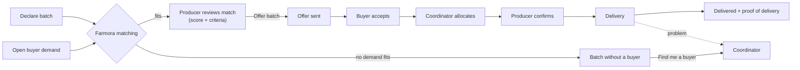
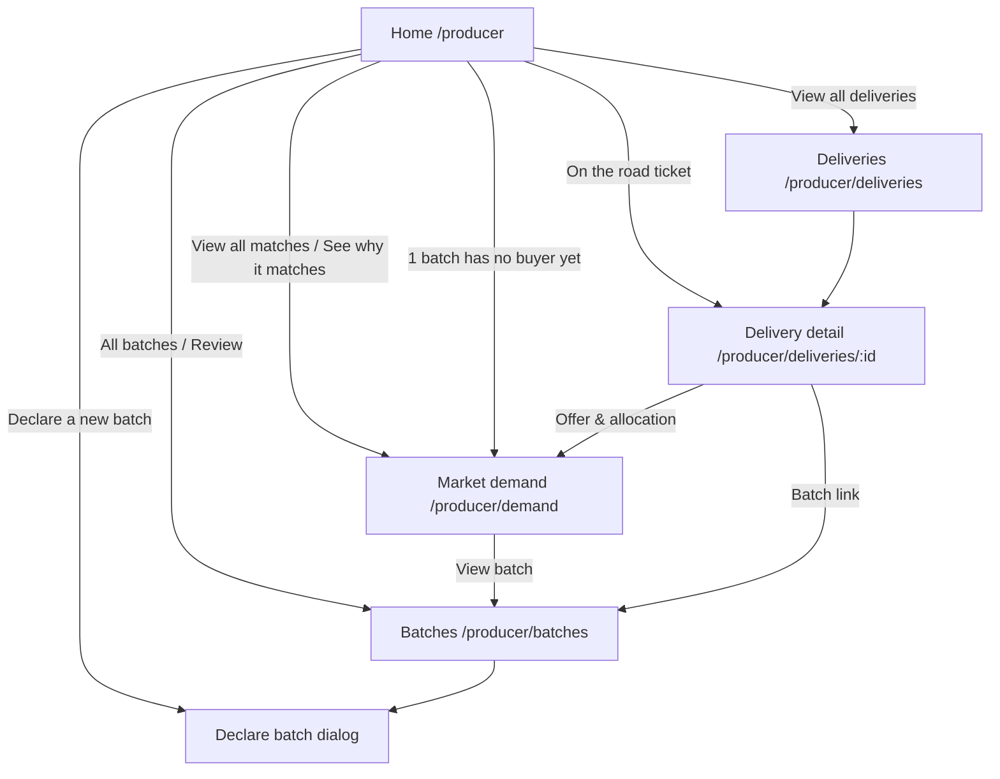
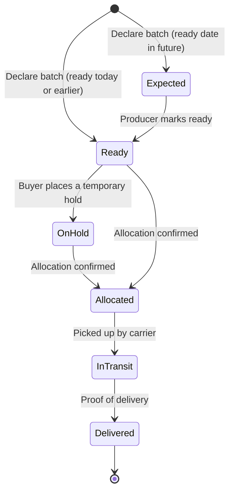
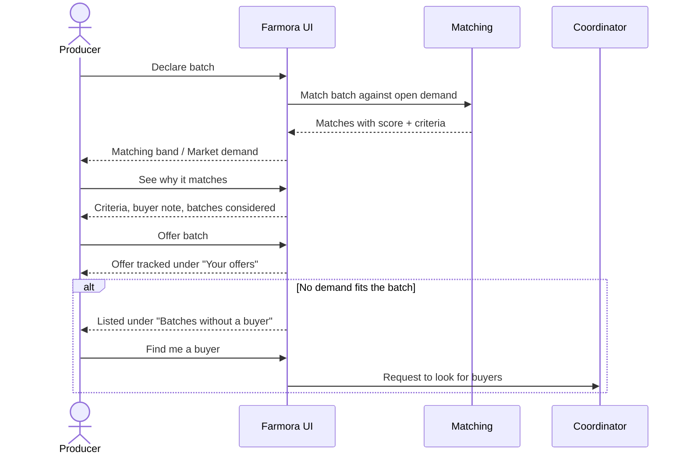
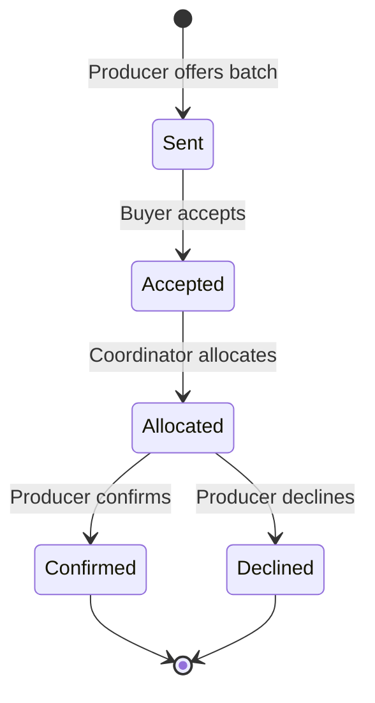
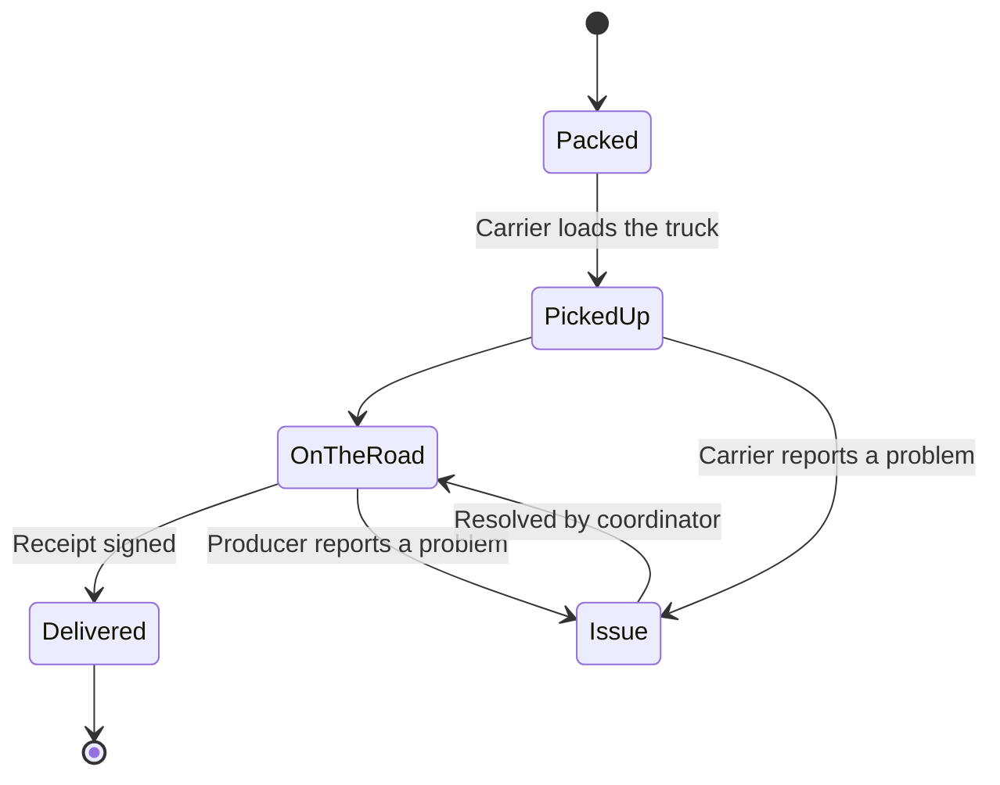

# Producer Flow

Access: all `/producer` routes require the Keycloak `PRODUCER` role, and producers land on `/producer` after login (see [auth docs](../auth/README.md#frontend-routing-by-role)).

This document describes how a producer (farm or cooperative) uses Farmora: declaring supply, reviewing system-generated matches, offering batches to buyers, confirming allocations and following deliveries. It covers the current frontend in `frontend/src/components/screens/Producer/`.

> **Status:** UI prototype on demo data. Matching, offers, deliveries and market insights run in the browser on mock data (`data/mockProducer.ts`); nothing is persisted and there is no backend API yet. The rules below are the intended behaviour the backend should take over.

## Core idea: the system matches, the producer decides

Matching is the platform's core feature. Producers never pair supply and demand by hand:

1. The producer **declares batches** (what, how much, grade, when it is ready, when it must be sold).
2. Farmora **matches** every open buyer demand against every declared batch and explains each match criterion by criterion.
3. The producer **reviews matches and offers a batch**.
4. The buyer accepts, a **coordinator allocates**, and the producer **confirms** the allocation.
5. The batch is **shipped**; the producer follows the delivery until proof of delivery.

Batches that no demand fits are flagged as **"Batches without a buyer"** so the producer can ask a coordinator to find one. Demands without a suitable batch are a buyer/coordinator concern and are not shown to producers.

## Pages

| Route | Page | Purpose |
| --- | --- | --- |
| `/producer` | Home | What needs the producer today: matching overview, tasks, harvest calendar, deliveries on the road, farm profile, AI market insights |
| `/producer/demand` | Market demand (matching) | All matches as demand ↔ batch pairs, match details, batches without a buyer, offer tracking |
| `/producer/batches` | Batches | Planning calendar and full batch list, declare a new batch, per-batch history |
| `/producer/deliveries` | Deliveries | All shipments, filtered by in transit / delivered / issues |
| `/producer/deliveries/:id` | Delivery detail | Live route map, timeline, cold-chain temperature, proof of delivery, report a problem |

`/producer/calendar` is an old route and redirects to `/producer/batches` (query string kept).

## Home

Ordered by priority, matching first:

1. **Greeting** with a one-line summary (buyers waiting for an offer, tasks open).
2. **Matching band**: the best match not yet offered (buyer demand ↔ score ↔ batch, criteria, *Offer* button), more matches, and how many batches have no buyer.
3. **Needs your attention**: work items only. Confirm an allocation (most urgent), a temporary hold expiring, a batch whose status should be updated.
4. **Harvest calendar**: two weeks around today; selecting a batch shows its status steps, quantities and actions inline.
5. **On the road**: shipments still travelling, as tickets (arrival time, route progress, problem if any).
6. Side column: **farm profile** and **From the market** (AI insights; details open in a dialog with analysis, evidence and sources).

## Batch lifecycle

Statuses in code: `expected`, `ready`, `on_hold`, `allocated`, `in_transit`, `delivered`. A producer can advance a batch one step at a time from the batch detail, or report an issue (lower yield, quality problem, no longer available, harvest delayed), which goes to a coordinator.

**Declaring a batch** (`DeclareBatchDialog`): product, variety, plot, quantity, grade A/B/C, expected harvest, ready-to-sell and sell-by dates. Validation: quantity > 0, ready ≥ harvest, sell-by > ready. After saving, the dialog reports how many open demands the new batch already matches.

## Matching

Implemented in `data/matching.ts` as a demo engine; the backend should own it so every role sees the same result.

**Hard rules** – a batch is not a match if any fails:

| Rule | Condition |
| --- | --- |
| Product | Batch product = demand product |
| Grade | Batch grade is in the demand's accepted grades (e.g. "Grade A–B") |
| Timing | Batch ready on or before the needed-by day, and still sellable on that day |
| Availability | Open quantity > 0 and the batch is not in transit or delivered |

**Score** (0–100) for eligible batches:

| Part | Weight | How |
| --- | --- | --- |
| Quantity | 30 | Share of the demanded quantity the open quantity covers |
| Grade | 25 | Full points once eligible |
| Timing / freshness | 30 | More days left before sell-by on delivery = higher |
| Location | 15 | Shorter delivery distance = higher |

Each match exposes five criteria (Product, Quantity, Grade, Timing, Location) as *pass*, *partial* (e.g. partial quantity, under 3 days of freshness, over 250 km) or *fail*, each with a plain-language reason. The best-scoring eligible batch is the suggested match; other batches considered are listed with their score or the rule they failed.

**Batches without a buyer** (`batchesWithoutBuyer`): active batches with open quantity that no demand fits. The reason is either "no buyer is asking for this product" or the closest buyer and the rule it misses.

## Offers and allocation

"Your offers" on the Market demand page shows each offer with a step tracker; offers waiting for the producer (allocated, not yet confirmed) come first and link to the *Confirm* card on Home. Confirming an allocation also clears the matching "temporary hold expiring" task and moves the batch to *Allocated*.

## Deliveries

The delivery detail page shows:

- **Route map** – MapLibre GL with the free OpenFreeMap "Positron" basemap and real road geometry (OSRM, stored in `data/routes.ts`); travelled part solid, remaining part dashed, red when the shipment has an issue.
- **Summary panel** – estimated arrival (flagged *Revised* when changed), batch → buyer, progress steps, carrier. Producers do not see or call the driver; contact goes through a coordinator.
- **Tabs** – timeline; cold-chain **temperature** (Apache ECharts gauge + trend, safe range 2–8 °C, plain-language verdict); proof of delivery (received by, quantity received, notes); **report a problem** (delayed, damaged, quantity mismatch, temperature, other) sent to a coordinator.

## What other roles do

| Step | Buyer | Coordinator |
| --- | --- | --- |
| Demand | Creates demand (product, quantity, grade, needed-by, destination) | Sees demands no batch fits |
| Offer | Accepts or rejects offers | — |
| Allocation | — | Allocates accepted offers; places/releases temporary holds |
| Problems | Checks goods on arrival | Handles batch issues, delivery problems and "find me a buyer" requests |

## Files

| Path | Contents |
| --- | --- |
| `ProducerLayout.tsx` | Top bar + state shared by all producer pages (batches, tasks, offers, issues) |
| `ProducerHome.tsx` | Home |
| `MarketDemandPage.tsx` | Matching page |
| `BatchesPage.tsx` | Batches page |
| `DeliveriesPage.tsx`, `DeliveryDetailPage.tsx` | Deliveries list and detail |
| `sections/` | Building blocks (MatchHero, AttentionList, CalendarGrid, BatchDetail, DeclareBatchDialog, OfferTracker, RouteMap, TemperatureCharts, MarketInsights…) |
| `data/matching.ts` | Matching rules, scores and criteria |
| `data/mockProducer.ts` | Demo batches, demands, tasks, offers, deliveries, insights |
| `data/routes.ts` | Stored road geometry for the delivery map |
| `styles/ProducerHome.css` | Styles for the whole producer area |

## Not done yet

- Backend API and persistence for batches, demands, matches, offers, allocations and deliveries; matching should move server-side.
- Real AI insight generation and data sources (e.g. a weather API such as Open-Meteo, market price feeds).
- Live vehicle positions and sensor readings for deliveries.
- Producer profile editing.
