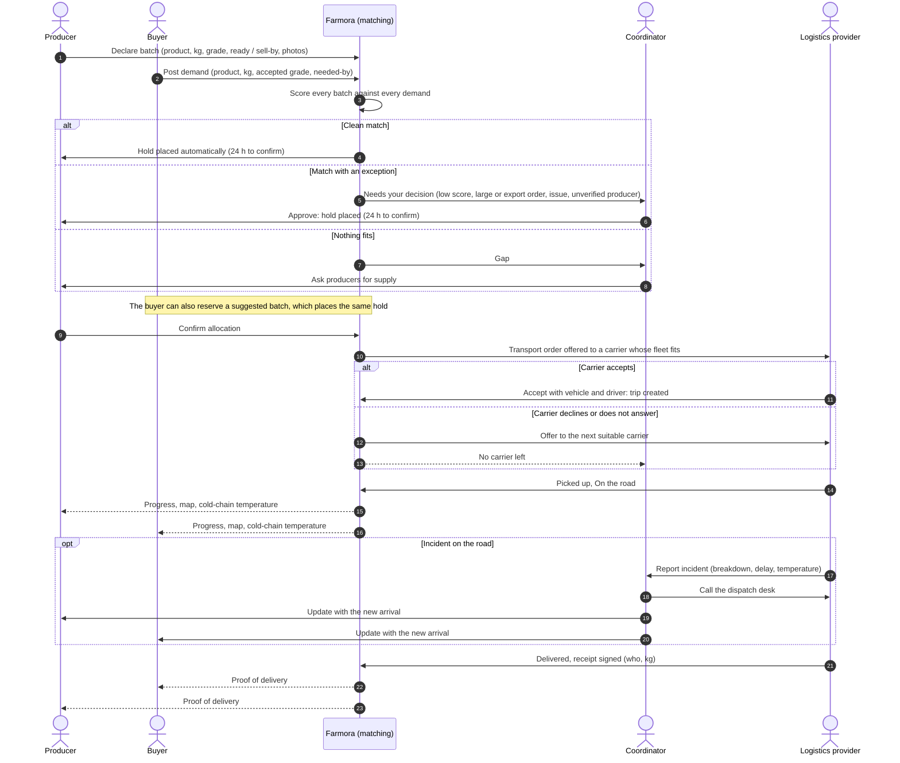

# Farmora: System Flow and Demo Script

This document is the entry point for understanding Farmora as a whole: who uses it, how a sale moves from a farm to a buyer's dock, where each role steps in, and how to demo the system role by role. Each role's own document has the detail: [producer](../producer/README.md), [buyer](../buyer/README.md), [coordinator](../coordinator/README.md), [logistics provider](../logistics/README.md), [authentication](../auth/README.md), [local setup](../setup/README.md).

> **Status.** Sign-up, login and role-based routing are real (Keycloak). The four role areas are UI prototypes on demo data: matching, holds, orders and deliveries run in the browser, nothing is saved, and **the areas do not share state** (an action in one area does not appear in another). The demo data is written so the same codes mean the same thing everywhere (D-551, B-104, S-307…), which is what lets the demo below tell one story across roles.

## 1. Roles

| Role | Who | Area | Main job | How the account gets the role |
| --- | --- | --- | --- | --- |
| Producer | Farm or cooperative | `/producer` | Declare batches, offer them to matches, confirm allocations | Self-registration (account type *Producer*) |
| Buyer | Supermarket, wholesaler, restaurant, exporter | `/buyer` | Post demands, reserve suggested batches, receive goods | Self-registration (*Buyer*) |
| Coordinator | Farmora operations staff | `/coordinator` | Decide matching exceptions, close gaps, handle incidents | Granted by an admin only |
| Logistics provider | Carrier (trucking company) | `/logistics` | Declare capacity, accept transport orders, run trips, report incidents | Self-registration (*Logistics*) |
| Admin | Farmora IT | — (Keycloak console) | Manage users and roles | Pre-provisioned (`farmora.admin`) |

After login every user lands on their own area (`/auth/callback` routes by role). Opening another role's area shows a no-access page.

## 2. End-to-end flow

One sale, from declared supply to proof of delivery. Matching and carrier selection are done by the system; people step in to decide, confirm and fix.



### The same flow as stages

| # | Stage | Producer | Buyer | Farmora (system) | Coordinator | Logistics |
| --- | --- | --- | --- | --- | --- | --- |
| 1 | Supply | Declares batches | — | Matches each new batch against open demand | — | — |
| 2 | Demand | — | Posts demand | Matches it against declared batches | — | — |
| 3 | Match | Sees matches with score and reasons; offers a batch | Sees suggested supply; can reserve | Holds clean matches on its own | Decides exceptions; closes gaps | — |
| 4 | Hold | Confirms within 24 h (or declines) | Can release a hold | Lapses holds that are not confirmed | Extends or releases holds | — |
| 5 | Allocation | Batch becomes *Allocated* | Demand becomes *Partly / Fully covered* | Creates a transport order | — | — |
| 6 | Transport order | — | — | Offers it to a carrier whose fleet fits | Gets orders no carrier takes | Accepts (vehicle, driver) or declines |
| 7 | Trip | Follows the map | Follows the map | Shows progress and temperature | Sees every trip, driver and dispatch desk | Picked up → On the road |
| 8 | Incident | Reports a batch or delivery problem | Reports a delivery problem | Flags it everywhere | Handles it, updates both sides | Reports incident with a new arrival time |
| 9 | Delivered | Sees proof of delivery | Sees proof; checks goods | Demand moves to *Completed* when all is delivered | — | Marks delivered with the signed receipt |

### Who talks to whom

Producers and buyers never contact drivers, and carriers never contact producers or buyers. Every problem goes to the coordinator, who calls the carrier's dispatch desk and updates both sides. This keeps one owner per incident.

## 3. Lifecycles

| Object | States | Moves on |
| --- | --- | --- |
| Batch (producer) | Expected → Ready → On hold → Allocated → In transit → Delivered | Producer marks ready; a hold is placed; allocation confirmed; carrier picks up; receipt signed |
| Demand (buyer) | New → Sourcing → Partly covered → Fully covered → Completed | Derived from its allocations, never set by hand |
| Allocation | Held (24 h) → Allocated → In transit → Delivered | Producer confirms; carrier picks up; receipt signed. A hold can be released or lapse |
| Transport order (logistics) | To answer → Accepted / Declined | Carrier answers; unanswered orders go to the next carrier |
| Delivery / trip | Packed → Picked up → On the road → Delivered (+ *Needs attention* while an incident is open) | Carrier updates each step; incidents set and clear the flag |

## 4. What the system decides and what people decide

Matching is the core of Farmora and stays system-generated and explainable: every match shows five criteria (product, quantity, grade, timing, location) with a plain-language reason.

| Decision | Who | Rule |
| --- | --- | --- |
| Which batch fits a demand | System | Hard rules (product, accepted grade, ready and still sellable by the needed-by day, open quantity) then a 0–100 score |
| Hold a clean match | System | Score ≥ 75 %, under 3,000 kg, not export, no reported problem, verified producer |
| Hold a match with an exception | Coordinator | Approve, choose another batch, or leave it |
| Confirm an allocation | Producer | Within 24 h of the hold |
| Which carrier gets an order | System | A carrier with a vehicle that has the payload, refrigeration if needed, and is free on the trip days |
| Take an order | Carrier | Accept with a vehicle and driver, or decline with a reason |
| Handle an incident | Coordinator | Calls the dispatch desk, sends both sides an update |

## 5. Incidents and where they land

| What goes wrong | Raised by | Lands in | Resolved by |
| --- | --- | --- | --- |
| Batch will ship less, or quality drops | Producer (batch issue) | Coordinator *Requests* | Coordinator: *Accept X kg less*; matching covers the rest from another batch |
| No batch fits a demand | System | Coordinator *Gaps*, buyer's demand page | Coordinator asks producers for supply |
| A batch fits no demand | System | Producer *Batches without a buyer*, coordinator *Gaps* | Producer asks a coordinator to find a buyer |
| Producer slow to confirm | System (hold under 6 h) | Coordinator and buyer alerts, producer tasks | Producer confirms; coordinator extends or releases |
| No vehicle fits an order | System | Carrier's order card says why | Carrier declines; next carrier; coordinator if none |
| Breakdown, delay, temperature out of range | Carrier (incident) or system (sensor) | Coordinator *Needs action*, trip flagged for everyone | Coordinator calls the desk and updates both sides; carrier marks *Back on schedule* |
| Goods damaged or short on arrival | Buyer (delivery problem) | Coordinator | Coordinator, with the proof of delivery |
| Producer documents uploaded | Producer | Coordinator *Requests* | Coordinator verifies; the producer's batches can then be matched automatically |

## 6. Demo script

About 25 minutes. The demo follows one shipment's life: supply, demand, matching, decisions, transport, delivery. Each role shows its own part of the story; the shared codes connect them.

| # | Role | Time | Shows |
| --- | --- | --- | --- |
| 0 | Landing and login | 2 min | Sign-up with account type, role-based landing, no-access page |
| 1 | Producer | 5 min | Declare supply, explainable matching, confirm an allocation |
| 2 | Buyer | 5 min | Post demand, suggested supply, reserve, producer trust |
| 3 | Coordinator | 6 min | Automatic matching, exceptions, incidents |
| 4 | Logistics provider | 5 min | Transport orders, trip updates, incident, capacity |
| 5 | Close the loop | 2 min | Delivery as the buyer sees it: map, temperature, proof |

**Why this order:** it follows the goods. Supply and demand come first because matching needs both; the coordinator comes after so the audience has already seen what the system matched on its own and can appreciate what is left for a person; logistics comes last because transport starts only after an allocation is confirmed.

### Before the demo

1. Start everything (see [local setup](../setup/README.md)): Docker (Keycloak + PostgreSQL), backend, `npm run dev` in `frontend/`. Maps need internet (OpenFreeMap tiles).
2. Create four accounts on `http://localhost:5173` → **Sign Up**, one per account type: *Producer*, *Buyer*, *Logistics*, and one more (any type) for the coordinator.
3. Give the coordinator account the `COORDINATOR` role and remove the self-chosen role (routing picks Producer, then Buyer, then Coordinator, then Logistics, so an extra role would win). In the Keycloak admin console: *Users* → the user → *Role mapping*. Or:

   ```powershell
   docker compose exec keycloak /opt/keycloak/bin/kcadm.sh config credentials --server http://localhost:8080 --realm master --user admin --password admin
   docker compose exec keycloak /opt/keycloak/bin/kcadm.sh add-roles -r agri-platform --uname <coordinator-username> --rolename COORDINATOR
   docker compose exec keycloak /opt/keycloak/bin/kcadm.sh remove-roles -r agri-platform --uname <coordinator-username> --rolename BUYER
   ```

4. Log each account in once in its own browser profile or private window, so switching roles during the demo is one click.
5. Reloading a page resets that area's demo data: reload every area just before you start.

### 0. Landing and login (2 min)

| Do | Say / point at |
| --- | --- |
| Open the landing page, click **Sign Up** | Registration asks for the account type; Keycloak grants the matching role. Coordinator and admin cannot be self-chosen |
| Log in as the producer | Lands on `/producer` automatically |
| Open `/buyer` with the producer still signed in | No-access page: areas are separated by role |

### 1. Producer: Hoa Phat Dragon Fruit Cooperative (5 min)

| Do | Say / point at |
| --- | --- |
| Home: the matching band | The system found buyers for this farm's batches; the producer never searches |
| Click **See why it matches** | Five criteria, each with a reason: matching is explainable |
| **Needs your attention**: confirm B-102 for Phu Tho Wholesale Market (3,000 kg, 5 h left) | A hold waits for the producer; confirming turns it into an allocation |
| **Declare a new batch** (product, kg, grade, dates, a photo) | Right after saving, the dialog says how many demands it already matches |
| Market demand: **Batches without a buyer** (B-112, grade C mango) | When nothing fits, the producer asks a coordinator to find a buyer |
| Deliveries: open S-303 | Truck broke down: route in red, revised arrival, temperature chart. The producer sees it but does not call the driver |

### 2. Buyer: GreenBasket Supermarkets (5 min)

| Do | Say / point at |
| --- | --- |
| Home: matching band for D-551 (2,000 kg red dragon fruit, needed in 2 days) | The buyer said what they need; supply was suggested |
| **Alerts** | Hold expiring on M-331, storm damage on P-140: the buyer is warned, not left to find out |
| Open D-551: **Suggested supply** → B-104 from Hoa Phat, **See why** | Same score and criteria the producer saw |
| Open batch B-104: photos, producer card | Rating, on-time rate, verified: the score says it fits, the track record says it will arrive |
| **Reserve** 2,000 kg | A 24 h hold; the kilograms leave the market at once |
| **Post a demand** for 500 kg mango, any grade | Matching runs immediately and says how many batches already fit |
| **Post a demand** for 300 kg avocado, Grade A, needed tomorrow, then open it | No batch fits (the nearest avocado is ready too late), with the reason; *Ask a coordinator* |

### 3. Coordinator (6 min)

| Do | Say / point at |
| --- | --- |
| Overview: map, figures, **Needs action** | The coordinator does not approve every match; this list is only what needs a person |
| Matching → **Holds** | Holds marked *System · 94 %* (for example D-551 ← B-104): the engine held clean matches on its own |
| Matching → **Needs your decision**: D-560, Mekong Export 4,500 kg | *Why this needs you*: large and export order. **Approve** |
| Matching → **Gaps**: D-575 avocado | Reason shown; **Ask producers for supply** |
| Requests → R-901 (P-140 storm damage) → **Accept 200 kg less** | Matching covers the 200 kg from another batch by itself: check Holds |
| Requests → R-906 → **Verify Green Hills Farm** | Verified producers can be matched automatically |
| Requests → R-902 → **Track S-303** | Only the coordinator sees the driver and the dispatch desk. **Send update** to buyer and producer; the item leaves Needs action |

### 4. Logistics provider: Delta Cold Chain (5 min)

| Do | Say / point at |
| --- | --- |
| Overview: figures, trips under way with the map, order table | The carrier's day at a glance |
| Transport orders: TO-714 (Phu Tho, 3,000 kg, cold, 3 h) | *No vehicle fits*, with the reason per truck. **Decline**: Farmora offers it to the next carrier |
| TO-711 (D-551, B-104 → GreenBasket DC) → **Accept**, vehicle 51C-482.19 | This is the batch the buyer reserved: the trip S-308 is created and the truck is booked |
| Open the new trip: **Picked up**, then **On the road** | Each step shows up for the producer and buyer |
| Incidents tab: report *Running late* with a new arrival | Goes to the coordinator, who updates both sides |
| Fleet: vehicles (regular / refrigerated, payload), 7-day availability, areas and routes, operating days | What the carrier declares decides which orders it is offered |
| Account & team | Company details, password via Keycloak, roles: drivers only update their own trips |

### 5. Close the loop (2 min)

| Do | Say / point at |
| --- | --- |
| Buyer → Deliveries → S-307 (Ham Kiem → GreenBasket DC, carried by Delta Cold Chain) | The same trip the carrier updates and the coordinator watches |
| Map, temperature, proof of delivery on a delivered shipment | The buyer checks the goods against the signed receipt |
| Wrap up | One sale, five roles: the system matched and picked the carrier; people confirmed, decided exceptions and handled incidents |

### If something goes wrong

| Problem | Fix |
| --- | --- |
| Map stays grey | No internet or the tile server is slow; the rest of the page still works, keep going |
| Landed on the wrong area | The account has more than one role; check role mapping in Keycloak |
| Demo data looks changed | Reload the page to reset that area |
| Login loops back to the landing page | Keycloak not running or the frontend is not on port 5173 |

## 7. Not built yet

- Backend API and database for batches, demands, matches, holds, orders and deliveries, so actions in one area reach the others.
- Matching, hold expiry and carrier selection running on the server.
- Live truck positions and temperature sensors.
- Ratings after delivery, admin area.
